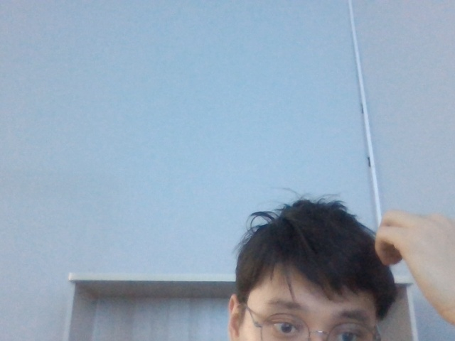

# Отчёт по лабораторной работе №1
## Занятие 1. Введение в биометрические системы. Подготовка среды

---

## 1. Результат установки и проверки библиотек (Шаги 1–3)

Виртуальное окружение `biometrics_env` (Python 3.10.7) создано и настроено. Скрипт `src/test_environment.py` выполнен успешно:

```
==================================================
Проверка установленных библиотек
==================================================
Python version:       3.10.7
OpenCV version:       5.0.0
NumPy version:        2.2.6
Matplotlib version:   3.10.9
scikit-image version: 0.25.2
scikit-learn version: 1.7.2
==================================================

Проверка веб-камеры...
Кадр успешно сохранён в reports\camera_test.jpg
Размер кадра: 640x480 пикселей

Проверка окружения завершена!
```

---

## 2. Тестовый снимок с веб-камеры (Шаг 4)

Снимок успешно считан с веб-камеры (`cv2.VideoCapture(0)`) и сохранён в `reports/camera_test.jpg` (разрешение `640×480` пикселей):



---

## 3. Сравнительная таблица биометрических модальностей

| Модальность | Уникальность | Стабильность во времени | Стоимость сенсора | Устойчивость к подделке |
|---|---|---|---|---|
| **Лицо** | Средняя (сходство у близнецов, влияние мимики) | Средняя (возраст, борода, макияж, очки) | Низкая (обычная RGB веб-камера) | ⚠️ Низкая (фото, видео с экрана, 3D-маска; требует PAD/NIR) |
| **Отпечаток пальца** | Высокая (индивидуальный узор папиллярных линий и минуций) | Высокая (формируется до рождения, но подвержен порезам и истиранию кожи) | Низкая–Средняя (оптический, ёмкостный или ультразвуковой сканер) | ⚠️ Средняя (возможны желатиновые/силиконовые муляжи при отсутствии Liveness) |
| **Голос** | Низкая–Средняя (ограниченная различимость в больших базах) | Низкая (сильно зависит от простуды, стресса, шума среды, возраста) | Очень низкая (любой штатный микрофон) | ❌ Низкая (легко атакуется диктофонной записью или Deepfake TTS/VC) |
| **Радужка глаза** | Очень высокая (~240+ независимых степеней свободы трабекулярного рисунка) | Очень высокая (неизменна в течение всей жизни после 1–2 лет) | Высокая (специализированная NIR-камера 700–900 нм с ИК-подсветкой) | ✅ Высокая (защищена роговицей, 3D-структура + реакция зрачка на свет) |

**Вывод:** Наиболее устойчивой к подделке является **радужка глаза** — её трабекулярный рисунок уникален даже у монозиготных близнецов, стабилен на протяжении всей жизни и крайне сложен для физического воспроизведения в условиях активного NIR-сканирования с контролем реакции зрачка.

---

## 4. Ответы на контрольные вопросы

### Вопрос 1: Чем identification отличается от verification?

| Параметр сравнения | Identification (Идентификация, 1:N) | Verification (Верификация, 1:1) |
|---|---|---|
| **Решаемый вопрос** | «Кто этот человек?» | «Действительно ли это тот человек, за кого он себя выдаёт?» |
| **Процедура сравнения** | Входной образец сравнивается со **всеми $N$** шаблонами в БД | Входной образец сравнивается только с **одним** шаблоном по предъявленному `Subject_ID` |
| **Необходимость предъявления ID** | Не требуется (только биометрия) | Требуется (смарт-карта, логин, PIN, номер паспорта) |
| **Вычислительная сложность** | $O(N)$ — растёт линейно с размером базы (требует индексации) | $O(1)$ — константное время, не зависит от размера БД |
| **Накопление ошибки ложного допуска** | $\text{FAR}_{1:N} = 1 - (1 - \text{FAR}_{1:1})^N \approx N \cdot \text{FAR}_{1:1}$ (растёт с $N$) | Определяется одиночным порогом $\text{FAR}_{1:1}$ |
| **Типичные сценарии применения** | Криминалистика, поиск в базах розыска (Watchlist), проход по лицу в метро | СКУД с картой доступа, разблокировка смартфона, подтверждение платежа |

---

### Вопрос 2: Из каких этапов состоит типовой pipeline биометрической системы?

```
enrollment → capture → feature extraction → matching → decision
```

1. **Enrollment (регистрация шаблона):** первичная регистрация пользователя, при которой биометрический образец проходит контроль качества, преобразуется в компактный шаблон (template) и сохраняется в базе данных.
2. **Capture (захват):** считывание «сырого» биометрического сигнала (кадра с камеры, скана отпечатка, аудиозаписи голоса) сенсором при обращении пользователя к системе.
3. **Feature Extraction (извлечение признаков):** предобработка сигнала (детекция, выравнивание, фильтрация шума) и выделение информативного числового вектора признаков (дескриптора/эмбеддинга).
4. **Matching (сравнение):** вычисление меры сходства (`Match Score` $S$, например косинусного сходства или расстояния Хэмминга) между текущим вектором признаков и эталонным шаблоном из БД.
5. **Decision (принятие решения):** сопоставление полученного `Score` $S$ с порогом $T$ и выдача управляющего решения (`Accept` / `Reject` или идентификатора найденного класса).

---

### Вопрос 3: Какая модальность в вашей таблице оказалась наиболее устойчивой к подделке и почему?

**Радужка глаза (Iris)** оказалась наиболее устойчивой к подделке по четырём фундаментальным причинам:
1. **Высокая энтропия и уникальность:** сложная сплетенная структура (крипты, борозды, кольца, пигментные пятна) формируется морфогенетически случайно и полностью различается даже у однояйцевых близнецов и между левым и правым глазом одного человека.
2. **Анатомическая защищённость и стабильность:** радужка является внутренним органом, защищённым прозрачной роговицей и водянистой влагой, поэтому она не стирается и не повреждается при бытовых контактах (в отличие от папиллярных линий пальцев).
3. **Съёмка в ближнем ИК-диапазоне (NIR, 700–900 нм):** даже тёмно-карие глаза, кажущиеся однородными в видимом свете, в NIR-спектре проявляют богатую текстуру, которую невозможно воспроизвести обычной цветной печатью или RGB-экраном смартфона.
4. **Естественный контроль «живости» (Liveness Detection):** зрачок живого глаза непрерывно совершает микроколебания (гиппус) и предсказуемо сужается при изменении яркости подсветки, а роговица даёт характерные зеркальные блики Пуркинье (4 отражения от поверхностей роговицы и хрусталика), что позволяет надёжно отсекать распечатки, муляжи и косметические линзы.

---

## 5. Итоговая структура проекта (`biometrics_env`)

```
biometrics_env/
├── datasets/
│   ├── orl_faces/                     # Датасет лиц ORL/AT&T (40 субъектов, 400 изображений 92x112)
│   └── fingerprints_fvc/              # Датасет отпечатков пальцев FVC (25 субъектов, 255 изображений 128x128)
├── notebooks/
│   ├── lab01_introduction.ipynb       # Ноутбук Занятия 1 (Введение и проверка среды)
│   ├── lab03_access_control.ipynb     # Ноутбук Занятия 3 (Проектирование биометрической СКУД и FAR/FRR)
│   └── lab04_datasets.ipynb           # Ноутбук Занятия 4 (Работа с биометрическими датасетами)
├── src/
│   ├── test_environment.py            # Скрипт проверки библиотек и веб-камеры (Занятие 1)
│   ├── lab03_access_control.py        # Генерация блок-схемы СКУД и графиков Decision Module (Занятие 3)
│   └── load_dataset.py                # Загрузка датасетов, визуализация 4x4, гистограммы и split (Занятие 4)
├── reports/
│   ├── camera_test.jpg                # Тестовый снимок с веб-камеры (Занятие 1)
│   ├── lab01_report.md                # Отчёт по Занятию 1
│   ├── lab03_architecture.drawio      # Диаграмма Enrollment и Verification в формате draw.io (Занятие 3)
│   ├── lab03_architecture_diagram.png # Архитектурная блок-схема СКУД с точками атак (Занятие 3)
│   ├── lab03_far_frr_decision_graph.png # График распределений Score S, кривых FAR/FRR и EER (Занятие 3)
│   ├── lab03_report.md                # Отчёт по Занятию 3
│   ├── dataset_samples.png            # Сетка 4x4 случайных лиц ORL Faces (Занятие 4)
│   ├── fingerprint_samples.png        # Сетка 4x4 случайных отпечатков пальцев (Занятие 4)
│   ├── dataset_class_distribution.png # Гистограммы распределения по классам (Занятие 4)
│   ├── subject_split_comparison.png   # Визуализация Split по субъектам vs Split по изображениям (Занятие 4)
│   └── lab04_report.md                # Отчёт по Занятию 4
└── pyvenv.cfg
```

---

*Дата выполнения: 16.10.2026*
