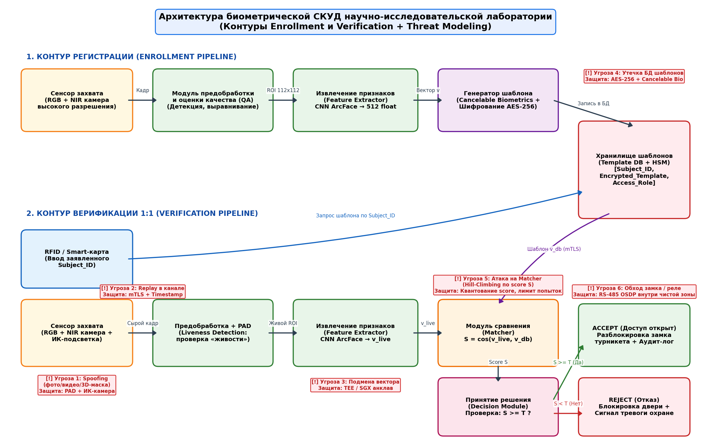
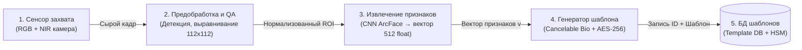
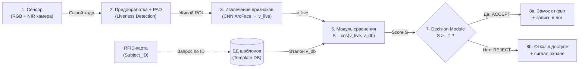
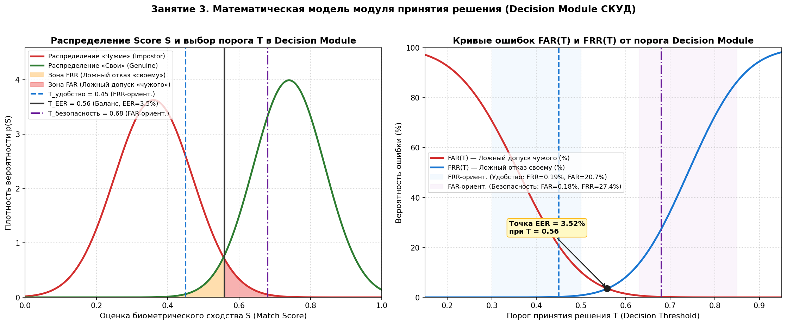

# Отчёт по лабораторной работе №3
## Занятие 3. Проектирование системы биометрического контроля доступа

---

## 1. Описание сценария использования (Шаг 1)

**Выбранный кейс:** Система биометрического контроля и управления доступом (СКУД) во внутреннюю **научно-исследовательскую лабораторию и серверную зону повышенной секретности** (штат: 150 сотрудников, пропускная способность: до 15 человек/мин в часы пик, критичность: высокая).

### Характеристики системы:
- **Режим работы:** Двухфакторная верификация **1:1 (Verification)**. Сотрудник прикладывает персональную бесконтактную смарт-карту (Mifare DESFire EV3), передающую заявленный идентификатор `Subject_ID`, и смотрит в терминал распознавания лиц.
- **Биометрическая модальность:** Лицо в видимом (RGB) и ближнем инфракрасном (NIR, 850 нм) диапазонах со встроенным контролем «живости» (Presentation Attack Detection / Liveness Detection).
- **Исполнительное устройство:** Электромагнитный замок шлюзовой двери лаборатории, управляемый контроллером СКУД по защищённому протоколу OSDP (RS-485 с шифрованием AES-128).
- **Требования к безопасности (FAR-ориентированный профиль):**
  - Вероятность ложного допуска злоумышленника ($\text{FAR}$) $\le 0.1\% - 0.2\%$ (порог сходства $T = 0.68$).
  - При 3 последовательных отказах (`Reject`) карта временно блокируется, а на пульт охраны отправляется тревожное оповещение с кадром с камеры.

---

## 2. Архитектура контуров Enrollment и Verification (Шаги 2–3)

Диаграмма спроектирована в формате **draw.io** (`reports/lab03_architecture.drawio`), а также сгенерирована программно (`reports/lab03_architecture_diagram.png`).

### 2.1. Контур регистрации (Enrollment Pipeline)
Выполняется однократно администратором безопасности при приёме сотрудника на работу в контролируемом помещении:
1. **Сенсор захвата (RGB + NIR камера):** выполняет съёмку серии кадров лица сотрудника при эталонном освещении.
2. **Модуль предобработки и оценки качества (QA):** выполняет детекцию лица (SSD/RetinaFace), проверку резкости, отсутствия сильных поворотов головы и бликов, а также геометрическое выравнивание (alignment) по 5 ключевым точкам до размера $112 \times 112$ пикселей.
3. **Модуль извлечения признаков (Feature Extractor):** глубокая свёрточная нейросеть (ArcFace / ResNet-50) преобразует нормализованное изображение лица в $L_2$-нормированный числовой вектор признаков $\mathbf{v} \in \mathbb{R}^{512}$ (`float32`).
4. **Генератор защищённого шаблона (Template Generator):** применяет необратимое преобразование (Cancelable Biometrics / BioHashing) и шифрует шаблон алгоритмом AES-256-GCM с ключом, хранящимся в аппаратном модуле безопасности (HSM).
5. **Хранилище шаблонов (Template Database):** сохраняет запись `(Subject_ID, Encrypted_Template, Access_Role, Salt)` в защищённой СУБД, исключая хранение исходных фотографий.

### 2.2. Контур верификации (Verification Pipeline, режим 1:1)
Выполняется при каждом проходе сотрудника через точку доступа в лабораторию:
1. **Идентификация заявки (`Subject_ID`) + Захват (Capture):** сотрудник прикладывает смарт-карту (считывается `Subject_ID`), а RGB+NIR-камера захватывает кадр лица и ИК-карту глубины/отражения.
2. **Модуль предобработки и Liveness Detection (PAD):** проверяет подлинность физического носителя (отсутствие распечатанного фото, экрана смартфона или 3D-маски по ИК-спектру и микротекстуре кожи). При успешной проверке выполняет выравнивание ROI.
3. **Модуль извлечения признаков (Feature Extractor):** тот же самый нейросетевой модуль (ArcFace), что и в контуре регистрации, вычисляет текущий вектор признаков $\mathbf{v}_{\text{live}} \in \mathbb{R}^{512}$.
4. **Модуль сравнения (Matcher):** по `Subject_ID` из БД шаблонов извлекается и расшифровывается в защищённой памяти эталонный вектор $\mathbf{v}_{\text{db}}$. Вычисляется косинусное сходство (нормированное к $[0, 1]$):
   $$S(\mathbf{v}_{\text{live}}, \mathbf{v}_{\text{db}}) = \frac{1 + \frac{\mathbf{v}_{\text{live}} \cdot \mathbf{v}_{\text{db}}}{\|\mathbf{v}_{\text{live}}\| \cdot \|\mathbf{v}_{\text{db}}\|}}{2}$$
5. **Модуль принятия решения (Decision Module):** сравнивает полученную оценку сходства $S$ с заданным порогом безопасности $T$:
   - Если $S \ge T \implies \text{ACCEPT}$ (разрешить доступ).
   - Если $S < T \implies \text{REJECT}$ (отказать в доступе).
6. **Исполнительное устройство (Actuator):** контроллер СКУД подаёт команду разблокировки на электромагнитный замок двери и записывает событие в журнал аудита.

---

## 3. Моделирование угроз (Threat Modeling, Шаг 4)

Ниже представлена таблица анализа уязвимостей всех узлов биометрического тракта (в соответствии с моделью 8 точек атак Н. Ратха / ISO/IEC 30107):

| № | Компонент (узел pipeline) | Потенциальная угроза / Тип атаки | Механизм реализации атаки | Архитектурная контрмера (Защита) |
|---|---|---|---|---|
| **1** | **Сенсор (Capture Device)** | **Presentation Attack (Spoofing)** — подделка биометрического предъявления | Демонстрация камере распечатанной фотографии сотрудника, видеозаписи с экрана планшета или силиконовой 3D-маски | Активная **NIR-подсветка (850 нм)** + стереопара (3D-глубина) + нейросетевой модуль **Liveness Detection (PAD)**, анализ моргания и пульсации (rPPG) |
| **2** | **Канал «Сенсор → Препроцессор»** | **Replay-атака / Man-in-the-Middle** (перехват и повтор сырого сигнала) | Подключение к шине USB/MIPI камеры, запись видеопотока легитимного пользователя и его повторная инжекция в линию | Взаимная криптографическая аутентификация сенсора и процессора (**mTLS**), подпись каждого кадра с меткой времени (`Timestamp`) и одноразовым числом (`Nonce`) |
| **3** | **Модуль предобработки и PAD** | **Обход Liveness-детектора / DoS-атака ослеплением** | Засветка камеры мощным ИК-излучателем или подача специально сформированного состязательного шума (Adversarial Patch на очках) | Аппаратные оптические полосовые фильтры, контроль экспозиции, ансамблирование независимых PAD-детекторов (RGB + NIR + Depth) |
| **4** | **Модуль извлечения признаков (Feature Extractor)** | **Троянская модификация модели (Feature Substitution)** | Замена весов нейросети или внедрение вредоносного кода, выдающего фиксированный вектор признаков $\mathbf{v}^*$ для выбранного злоумышленника | Проверка цифровой подписи прошивки и весов модели при загрузке (**Secure Boot**), выполнение инференса внутри доверенного анклава (**TEE / Intel SGX / ARM TrustZone**) |
| **5** | **Хранилище шаблонов (Template Database)** | **Утечка базы шаблонов / Подмена шаблона в БД** | SQL-инъекция или кража дампа БД с целью реконструкции лица (Model Inversion Attack) либо записи вектора злоумышленника под чужим `Subject_ID` | Хранение **отзываемых шаблонов (Cancelable Biometrics / BioHashing)** вместо «сырых» векторов; шифрование **AES-256-GCM** с ключами в **HSM**; контроль целостности записей (HMAC-SHA256) |
| **6** | **Канал «БД шаблонов → Matcher»** | **Перехват и подмена эталонного шаблона при передаче** | Атака посредника (MitM) в локальной сети между сервером БД и терминалом верификации | Передача шаблонов исключительно по зашифрованному каналу **TLS 1.3**, выполнение сравнения на защищённом сервере без выгрузки открытого шаблона на терминал |
| **7** | **Модуль сравнения (Matcher)** | **Hill-Climbing атака (подбор по отклику оценки сходства $S$)** | Многократная отправка синтезированных векторов с постепенной модификацией тех координат, которые увеличивают возвращаемый `Match Score` $S$ | **Квантование (округление)** или полное скрытие числового `Score S` от внешних интерфейсов (наружу передаётся только бинарный ответ `Accept/Reject`), жёсткий **Rate Limiting** (блокировка после 3 неудачных попыток) |
| **8** | **Модуль принятия решения → Замок (Decision / Actuator)** | **Перехват управления реле / Физическое шунтирование замка** | Подача ложного сигнала «Открыть» напрямую на реле электромагнитного замка или замыкание проводов считывателя на внешней стороне двери | Размещение контроллера управления замком **внутри защищённого периметра** («чистой зоны»), связь между терминалом и контроллером по шифрованному протоколу **OSDP v2 (AES-128)** с контролем вскрытия корпуса (Tamper Switch) |

---

## 4. График работы модуля принятия решения (Decision Module: FAR vs FRR)

Для количественного обоснования архитектуры **Decision Module** (Контрольный вопрос №3) смоделировано распределение оценок биометрического сходства $S \in [0, 1]$ для «своих» сотрудников ($\text{Genuine}$, $\mu_1 = 0.74, \sigma_1 = 0.10$) и «чужих» ($\text{Impostor}$, $\mu_0 = 0.36, \sigma_0 = 0.11$), а также построены кривые ошибок $\text{FAR}(T)$ и $\text{FRR}(T)$ с помощью скрипта `src/lab03_access_control.py`.

### Ключевые выводы по графику:
1. **Точка равной ошибки (EER — Equal Error Rate):** при пороге $T_{\text{EER}} = 0.56$ вероятности ложного допуска и ложного отказа совпадают и составляют $\text{EER} = 3.52\%$.
2. **FRR-ориентированная система ($T_{\text{удобство}} = 0.45$, синяя зона):** порог смещён влево. Вероятность ложного отказа сотруднику минимальна ($\text{FRR} = 0.19\%$), система работает максимально комфортно и быстро, но риск пропуска постороннего возрастает ($\text{FAR} = 20.66\%$). Применяется на общих турникетах бизнес-центров, в фитнес-клубах и при разблокировке пользовательских устройств.
3. **FAR-ориентированная система ($T_{\text{безопасность}} = 0.68$, фиолетовая зона):** порог смещён вправо. Вероятность ложного допуска злоумышленника сведена к минимуму ($\text{FAR} = 0.18\%$), однако сотрудникам иногда приходится повторно смотреть в камеру из-за повышенного $\text{FRR} = 27.43\%$. Именно этот режим выбран для нашей **научно-исследовательской лаборатории**.

---

## 5. Краткий план презентации / защиты схемы (3–5 минут)

1. **Вступление и выбор кейса (45 сек):**
   - Объект защиты — научно-исследовательская лаборатория. Выбрана двухфакторная схема верификации `1:1` (RFID-карта Mifare DESFire + лицо RGB/NIR), так как режим `1:1` исключает накопление ошибки идентификации $1:N$ и ускоряет проверку до $< 0.3$ с.
2. **Сравнение контуров Enrollment и Verification (1 мин):**
   - Демонстрация блок-схемы (`lab03_architecture_diagram.png`). Оба контура используют **единый модуль предобработки и извлечения признаков (CNN ArcFace)** — это гарантирует, что векторы $\mathbf{v}_{\text{db}}$ и $\mathbf{v}_{\text{live}}$ находятся в одном метрическом пространстве $\mathbb{R}^{512}$.
   - Различие начинается после Feature Extractor: в Enrollment вектор преобразуется в защищённый отзываемый шаблон и записывается в БД, а в Verification он поступает в Matcher для расчёта косинусной близости $S = \cos(\mathbf{v}_{\text{live}}, \mathbf{v}_{\text{db}})$ и последующего сравнения с порогом $T$ в Decision Module.
3. **Анализ угроз и защита (1.5 мин):**
   - Наиболее уязвимая точка — **сенсор** (находится в физическом доступе злоумышленника, подвержен spoofing-атакам с фото/видео). Контрмера: двухспектральная съёмка RGB+NIR и модуль PAD (Liveness Detection).
   - Вторая критическая точка — **БД шаблонов**. Поскольку биометрию человека нельзя «перевыпустить» как пароль, шаблоны хранятся в виде Cancelable Biometrics под шифрованием AES-256 в HSM.
4. **Настройка Decision Module по графику FAR/FRR (1 мин):**
   - Демонстрация графика `lab03_far_frr_decision_graph.png`. Для спецлаборатории порог $T$ сдвинут вправо от точки EER ($T = 0.68 > T_{\text{EER}} = 0.56$), что переводит систему в **FAR-ориентированный режим** с каскадным правилом «до 3 попыток сканирования перед вызовом охраны».

---

## 6. Ответы на контрольные вопросы

### Вопрос 1: Почему шаблон не хранят в виде «сырого» изображения?

1. **Необратимость компрометации биометрии (Безопасность и приватность):** Пароль при утечке можно сменить, но лицо, радужку или отпечаток пальца человек поменять не может. Если злоумышленник украдёт «сырые» фотографии из БД, он сможет изготовить муляжи для обмана других систем (банковских, государственных) и скомпрометировать персональные данные (GDPR / ФЗ-152). Числовой шаблон (особенно преобразованный методом *Cancelable Biometrics* или *BioHashing*) не позволяет напрямую увидеть лицо, а при утечке может быть перевыпущен с новым ключом трансформации.
2. **Скорость сравнения и объём памяти (Производительность):** Сырое изображение RGB $1920 \times 1080$ занимает $\sim 6\text{ МБ}$ и непригодно для прямого попиксельного сравнения из-за чувствительности к малейшим сдвигам, мимике и освещению. Вектор признаков (эмбеддинг из 512 чисел `float32`) занимает всего **$2\text{ КБ}$** (в 3000 раз меньше!), инвариантен к ракурсу и освещению, а вычисление скалярного произведения двух векторов в Matcher занимает доли миллисекунды.

---

### Вопрос 2: На каком этапе pipeline проще всего провести атаку и почему?

Проще всего провести атаку на **1-м этапе — на уровне сенсора (Presentation Attack / Spoofing)**.
- **Почему:**
  1. **Физическая доступность:** Сенсор (камера, сканер отпечатка, микрофон) по своей природе вынесен во внешнюю, неконтролируемую среду для взаимодействия с пользователем, тогда как остальные модули (Feature Extractor, БД, Matcher, контроллер замка) находятся внутри защищённого корпуса или на закрытом сервере.
  2. **Отсутствие необходимости в технических спецсредствах и доступе к коду:** Для атаки на БД или внутренние шины данных нужны навыки взлома сети, эксплуатации уязвимостей ОС или вскрытия аппаратуры. Для атаки же на сенсор злоумышленнику достаточно распечатать фотографию из соцсетей, показать видео на экране смартфона или сделать желатиновый слепок пальца.

---

### Вопрос 3: Чем отличается FAR-ориентированная система (высокая безопасность) от FRR-ориентированной (высокое удобство) на уровне архитектуры decision-модуля?

На уровне архитектуры **Decision Module** эти системы отличаются не только значением порога $T$, но и логикой обработки повторных попыток, многофакторностью и реакцией на отказ:

| Архитектурный параметр Decision Module | FAR-ориентированная система (Высокая безопасность: лаборатория, банк, режимный объект) | FRR-ориентированная система (Высокое удобство: вход в офис, смартфон, фитнес-клуб) |
|---|---|---|
| **Положение порога $T$** | Высокий порог: $T \gg T_{\text{EER}}$ ($\text{FAR} \to 0$, например $\le 0.01\%$, ценой роста $\text{FRR}$) | Низкий порог: $T < T_{\text{EER}}$ ($\text{FRR} \to 0$, например $\le 0.1\%$, ценой умеренного $\text{FAR}$) |
| **Логика повторных попыток (Retry Policy)** | Каскадная проверка: чтобы компенсировать высокий одиночный $\text{FRR}$, модуль разрешает серию из $K=2\dots3$ быстрых кадров подряд ($\text{Accept}$, если хотя бы один кадр дал $S \ge T_{\text{high}}$ и $\text{PAD}=\text{True}$), но после 3 неудачных сессий жёстко блокирует ID | Мгновенное решение по первому же кадру с минимальной задержкой; при отказе — мягкий fallback на быстрый ввод PIN-кода |
| **Многомодальное слияние (Score/Decision Fusion)** | Конъюнктивное правило (**И / AND-правило**) или строгий мультифактор: для допуска требуется одновременное выполнение $(S_{\text{face}} \ge T_1) \land (S_{\text{iris/finger}} \ge T_2) \land (\text{Liveness} \ge T_{\text{pad}})$ | Дизъюнктивное правило (**ИЛИ / OR-правило**): достаточно срабатывания одного удобного признака либо адаптивное снижение порога при высоком качестве кадра |
| **Реакция на `Reject` и эскалация** | Формирование тревожного события в SIEM/СКУД, сохранение фото инцидента, блокировка учётной записи, вызов службы безопасности | Отсутствие блокировки при единичных отказах, предложение протереть сенсор или приложить пропуск |

---

*Дата выполнения: 16.10.2026*
