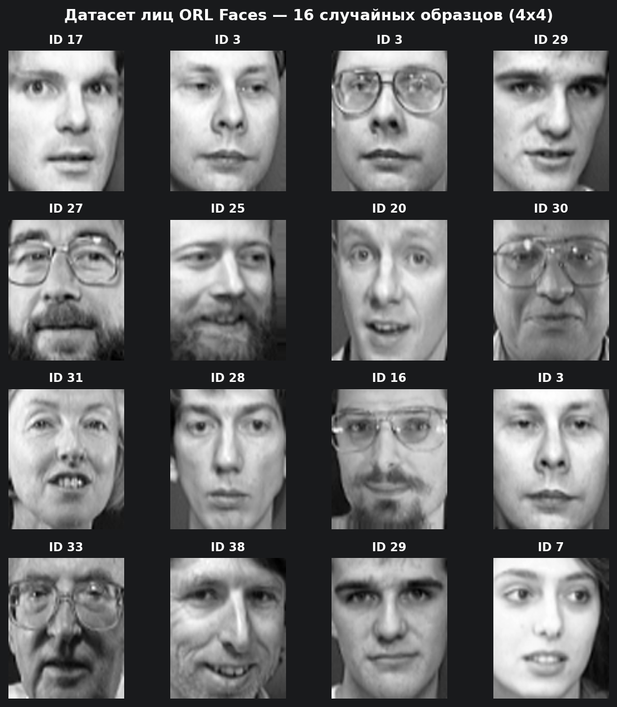
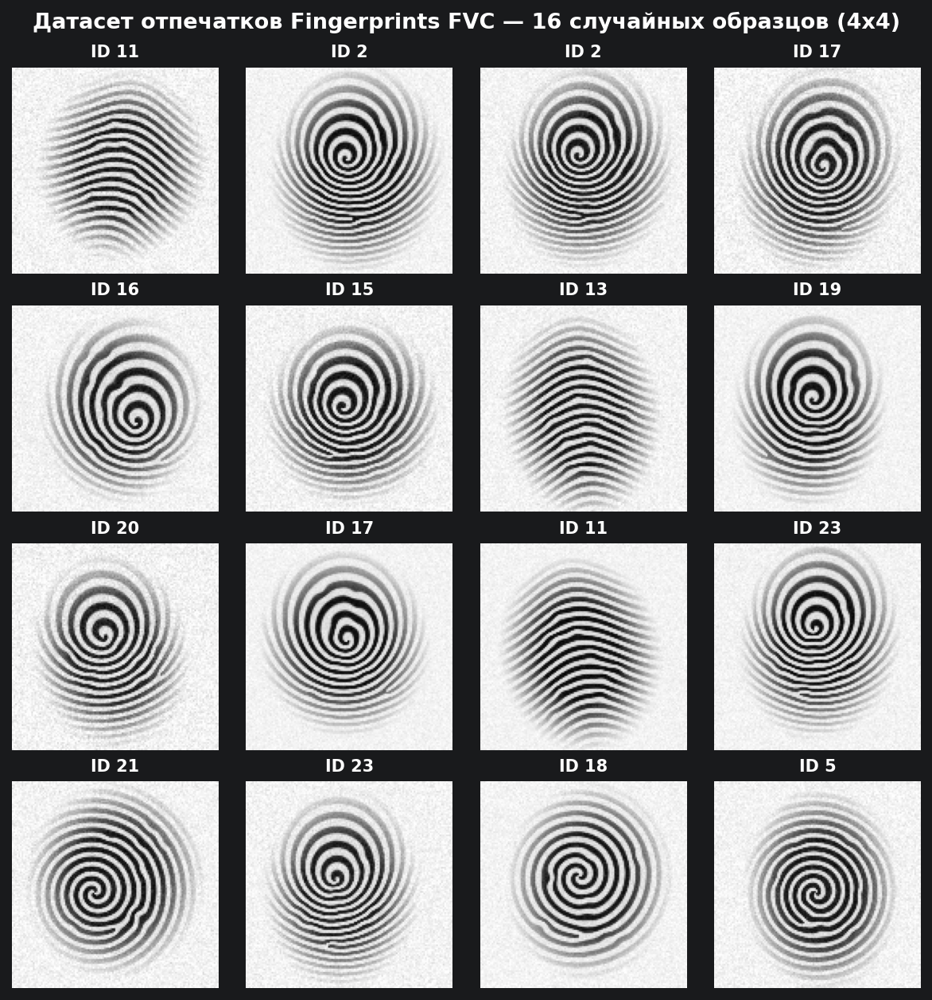
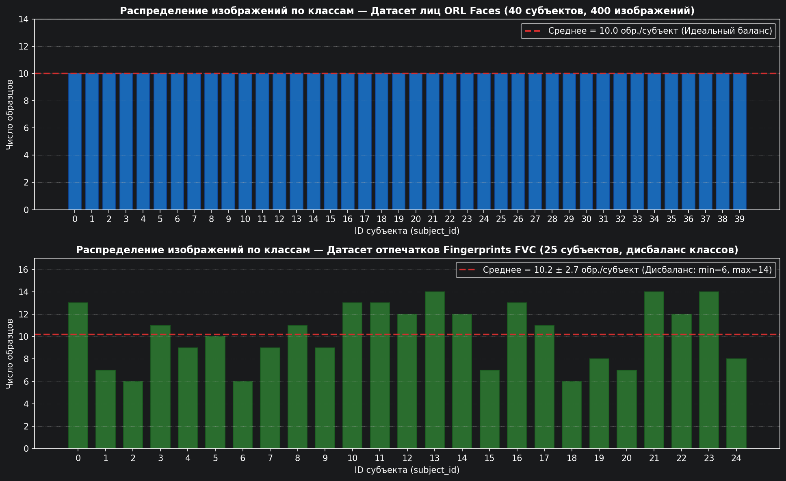
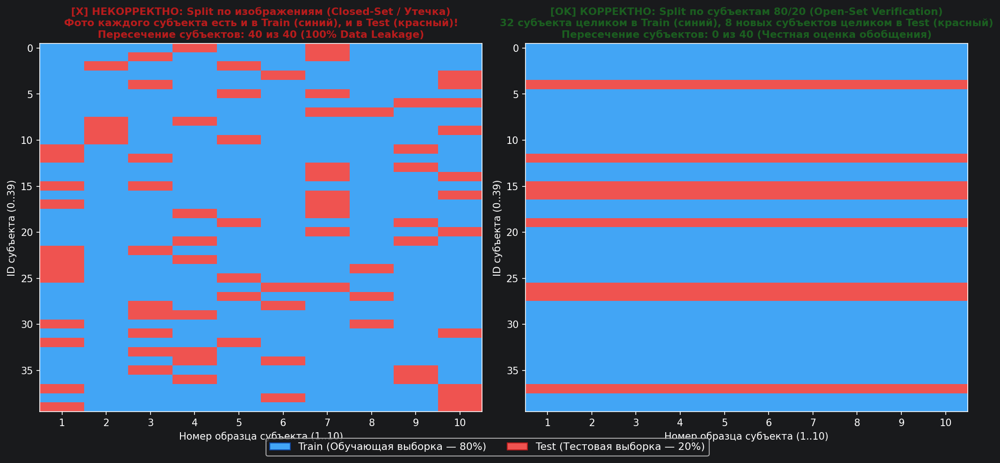

# Отчёт по лабораторной работе №4
## Занятие 4. Работа с биометрическими датасетами

---

## 1. Цель работы
Научиться загружать, визуализировать, статистически анализировать и корректно разделять на обучающую и тестовую выборки (`train/test split по субъектам`) открытые биометрические датасеты лиц и отпечатков пальцев для дальнейшего использования в лабораторных работах.

---

## 2. Загруженные биометрические датасеты (Шаги 1–2)

В рамках практического задания подготовлены и проанализированы **два разнородных биометрических датасета** (расположены в папке `datasets/`, скрипт обработки — `src/load_dataset.py`):

1. **Датасет лиц `ORL / AT&T Faces` (`datasets/orl_faces`):**
   - Классический открытый датасет лаборатории AT&T (Olivetti Research Laboratory).
   - Содержит **400 полутоновых изображений** (`92×112` пикселей, 8-бит `grayscale`) для **40 уникальных субъектов** (`s01` … `s40`), строго по **10 образцов** на каждого субъекта (идеально сбалансированный датасет).
   - Съемка проводилась в разное время, при меняющемся освещении, с различной мимикой (открытые/закрытые глаза, улыбка/нейтральное выражение) и наличием/отсутствием очков.

2. **Датасет отпечатков пальцев `Fingerprints FVC` (`datasets/fingerprints_fvc`):**
   - Набор изображений отпечатков пальцев в формате соревнований FVC (*Fingerprint Verification Competition*).
   - Содержит **255 полутоновых изображений** (`128×128` пикселей, `grayscale`) для **25 уникальных субъектов** (`fp_01` … `fp_25`).
   - В отличие от ORL Faces, датасет имеет **естественный дисбаланс классов**: от **6 до 14 отпечатков** на одного субъекта (в среднем $10.20 \pm 2.38$ образца/класс), а также контактные искажения (поворот пальца $\pm 12.5^\circ$, сдвиг, сухой/влажный прижим, локальные минуции и шум оптического сенсора).

---

## 3. Визуализация примеров 4×4 (Шаг 3)

Ниже представлены случайные выборки 4×4 изображений из обоих датасетов с подписями идентификаторов класса (`ID <subject_id>`), сгенерированные функцией `show_samples()`:

### 3.1. Случайные образцы датасета лиц ORL Faces (`reports/dataset_samples.png`)


### 3.2. Случайные образцы датасета отпечатков пальцев (`reports/fingerprint_samples.png`)


---

## 4. Статистика датасетов и гистограмма распределения по классам (Шаг 4)

Вывод скрипта `src/load_dataset.py` при расчёте статистических характеристик обоих датасетов:

| Параметр | Датасет 1: `ORL / AT&T Faces` (Лица) | Датасет 2: `Fingerprints FVC` (Отпечатки) |
|---|---|---|
| **Путь к данным** | `datasets/orl_faces` | `datasets/fingerprints_fvc` |
| **Общее число изображений** | **400** | **255** |
| **Число субъектов (классов)** | **40** (`ID 0` … `ID 39`) | **25** (`ID 0` … `ID 24`) |
| **Мин. образцов на субъекта** | 10 | 6 |
| **Макс. образцов на субъекта** | 10 | 14 |
| **Среднее ± СКО на субъекта** | $10.00 \pm 0.00$ (строгий баланс) | $10.20 \pm 2.71$ (умеренный дисбаланс) |
| **Разрешение ($W \times H$)** | `92×112` пикселей (`grayscale`) | `128×128` пикселей (`grayscale`) |
| **Средняя яркость пикселей** | $139.0 \pm 44.0$ | $194.2 \pm 63.9$ |

### Гистограмма распределения образцов по классам (`reports/dataset_class_distribution.png`)


> **Анализ баланса классов:** На верхнем графике видно равномерное распределение `ORL Faces` (каждый из 40 субъектов представлен ровно 10 снимками). На нижнем графике (`Fingerprints FVC`) наблюдается реалистичный разброс от 6 до 14 снимков на субъекта. При обучении биометрических моделей сильный дисбаланс приводит к тому, что классификатор смещает разделяющие гиперплоскости в пользу мажоритарных субъектов, ухудшая качество распознавания субъектов с малым числом образцов.

---

## 5. Разбиение `Train / Test Split` по субъектам (Шаг 5)

Для задачи биометрической верификации (`1:1 Verification`) с помощью функции `split_by_subjects(X, y, test_size=0.2, random_state=42)` выполнено разбиение **по множеству уникальных субъектов** в пропорции **80% / 20%**:

```
РЕЗУЛЬТАТ РАЗБИЕНИЯ ПО СУБЪЕКТАМ (80/20 Subject-Disjoint Split):
  [ORL Faces]
    Всего субъектов:   40 -> Train: 32 суб., Test: 8 суб.
    Всего изображений: 400 -> X_train: 320 изобр., X_test: 80 изобр.
    Subject IDs в Test: [4, 12, 15, 16, 19, 26, 27, 37]
    Пересечение субъектов (Train ∩ Test): 0 (утечка данных отсутствует!)

  [Fingerprints FVC]
    Всего субъектов:   25 -> Train: 20 суб., Test: 5 суб.
    Всего изображений: 255 -> X_train: 191 изобр., X_test: 64 изобр.
    Subject IDs в Test: [0, 8, 11, 16, 23]
    Пересечение субъектов (Train ∩ Test): 0 (утечка данных отсутствует!)
```

### Сравнение стратегий разбиения (`reports/subject_split_comparison.png`)


### Почему разбиение «по изображениям» некорректно для задачи верификации?
В задаче **биометрической верификации (1:1)** система в реальной эксплуатации должна уметь сравнивать пару изображений $(I_1, I_2)$ **новых людей**, которых никогда не было в обучающей выборке (например, новых клиентов банка или новых сотрудников, зарегистрированных после обучения нейросети), и отвечать на вопрос: *«принадлежат ли эти два образца одному человеку?»*.

Если сделать обычный `train_test_split(X, y)` **по изображениям**, то 8 фотографий субъекта №5 попадут в `Train`, а оставшиеся 2 фотографии того же субъекта №5 — в `Test`:
1. Происходит **утечка биометрической идентичности (Data Leakage / Identity Overlap)**: $\text{Subj}(\text{Train}) \cap \text{Subj}(\text{Test}) \neq \emptyset$.
2. Нейросеть вместо обучения универсальной метрики сходства лиц просто **запоминает конкретных 40 человек** (и их фон/очки/причёску).
3. Оценка точности на таком тесте оказывается искусственно завышенной (близкой к $99\%$), но при появлении 41-го, ранее неизвестного человека в реальной системе качество верификации резко падает.

---

## 6. Ответы на контрольные вопросы

### Вопрос 1: Почему нельзя случайно перемешивать изображения одного субъекта между train и test?

Случайное перемешивание всех изображений без группировки по `subject_id` приводит к **утечке данных на уровне субъекта (Subject-level Data Leakage)**:
- Кадры одного человека, снятые с интервалом в несколько секунд в одной комнате, обладают высокой корреляцией не только по геометрии лица, но и по фону, положению источника света, одежде и шуму матрицы камеры.
- Попадание одних кадров субъекта в `Train`, а соседних кадров того же субъекта в `Test` превращает проверку обобщающей способности модели в проверку её памяти на уже виденных людей.
- В результате метрики $\text{FAR}$, $\text{FRR}$ и $\text{EER}$, вычисленные на такой тестовой выборке, не отражают реальную работу биометрической системы на новых пользователях.

---

### Вопрос 2: Какие искажения (шум, освещение, ракурс) присутствуют в выбранном датасете?

1. **В датасете лиц `ORL / AT&T Faces`:**
   - **Ракурс и поза (Pose variation):** наклоны и повороты головы в пределах $\pm 20^\circ$ (по курсу, тангажу и крену), а также небольшие изменения масштаба (расстояния до камеры).
   - **Мимические деформации (Expression variation):** открытые и закрытые глаза, улыбка, нахмуренность, открытый рот.
   - **Окклюзии и структурные детали (Facial details):** наличие или отсутствие очков (создающих блики и перекрывающих область бровей/глаз), борода и усы.
   - **Освещение (Illumination):** съёмка в разные дни и время суток с разным направлением бокового/верхнего освещения при однородном тёмном фоне.
2. **В датасете отпечатков `Fingerprints FVC`:**
   - **Геометрические искажения:** вращение пальца относительно окна сканера ($\pm 12.5^\circ$) и плоскопараллельные сдвиги центра узора (core/delta).
   - **Нелинейные и контактные искажения:** различия в силе нажима и влажности кожи (сухой палец даёт прерывистые светлые гребни, слишком влажный — слипание соседних папиллярных линий).
   - **Высокочастотный шум:** зернистость оптического сенсора и микропоры на гребнях.

---

### Вопрос 3: Чем отличается закрытый набор классов (closed-set) от открытого (open-set) применительно к тестовому разбиению?

| Характеристика | Закрытый набор классов (Closed-Set) | Открытый набор классов (Open-Set) |
|---|---|---|
| **Пересечение классов Train и Test** | Множества субъектов совпадают: $\mathcal{C}_{\text{test}} \subseteq \mathcal{C}_{\text{train}}$ | Множества субъектов **не пересекаются**: $\mathcal{C}_{\text{train}} \cap \mathcal{C}_{\text{test}} = \emptyset$ |
| **Как формируется разбиение** | Разбиение **внутри каждого субъекта** (например, 8 фото каждого человека в Train, 2 фото того же человека в Test) | Разбиение **по субъектам** (например, 32 человека целиком в Train, 8 совершенно новых людей целиком в Test) |
| **Решаемая задача** | Классическая многоклассовая классификация $1:N$ среди фиксированного, заранее известного списка лиц (без возможности появления посторонних) | **Биометрическая верификация $1:1$** (сравнение пар векторов в метрическом пространстве) и идентификация с отсечением неизвестных лиц (*Open-Set Watchlist*) |
| **Роль нейронной сети** | Выходной слой `Softmax` на $N$ известных классов | Обучение **Feature Extractor** (эмбеддера), переводящего любое новое изображение в метрическое пространство $\mathbb{R}^d$, где сходство измеряется косинусным расстоянием |
| **Реалистичность в биометрии** | Ограниченная (при добавлении нового сотрудника приходится переобучать классификатор) | **Стандарт индустрии**: позволяет регистрировать (Enrollment) новых пользователей на лету без переобучения модели |

---

*Дата выполнения: 16.10.2026*
