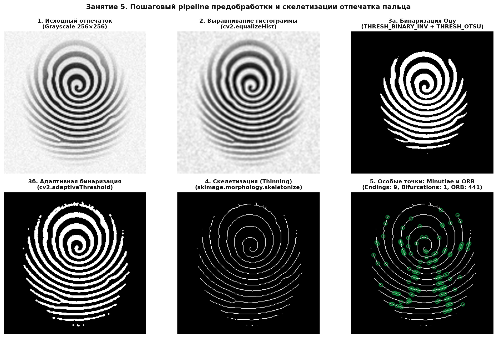
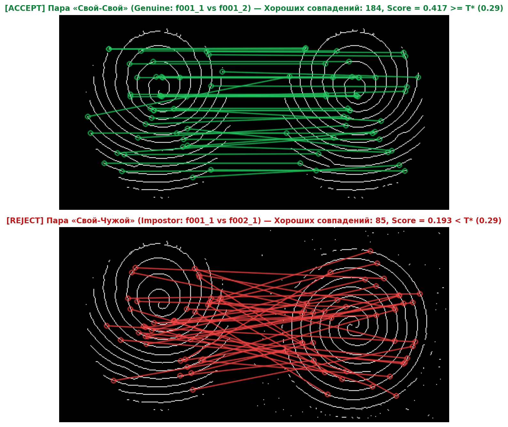
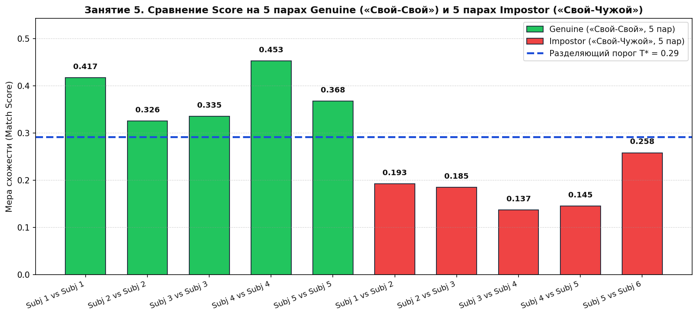
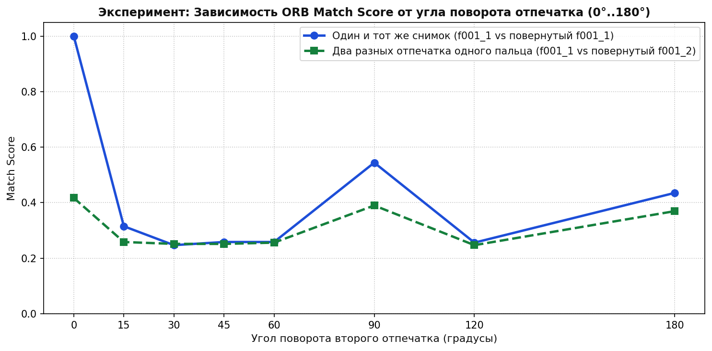

# Отчёт по лабораторной работе №5
## Занятие 5. Распознавание отпечатков пальцев (Python/OpenCV)

---

## 1. Цель работы
Реализовать базовый pipeline предобработки и сравнения отпечатков пальцев: нормализация контраста, бинаризация (метод Оцу и адаптивная пороговая обработка), скелетизация (`thinning`), поиск особых точек (минуций и дескрипторов ORB) и сопоставление пар отпечатков («свой-свой» и «свой-чужой») с выбором порогового значения `Score`.

---

## 2. Пошаговый pipeline обработки отпечатка пальца (Шаги 1–4)

Скрипт реализации: `src/fingerprint_matching.py`.
Этапы обработки в функции `preprocess()`:
1. **Загрузка и подавление высокочастотного шума:** чтение изображения в градациях серого (`cv2.IMREAD_GRAYSCALE`) и сглаживание гауссовым фильтром `5×5` ($\sigma = 1.2$) для устранения шума оптического сенсора и микропор.
2. **Локальное выравнивание контраста:** применение `CLAHE` (`cv2.createCLAHE(clipLimit=2.0, tileGridSize=(8,8))`) для выравнивания освещённости и силы прижима по всей площади подушечки пальца.
3. **Бинаризация (Инвертированная — гребни белые `255`, бороздки чёрные `0`):**
   - Глобальная бинаризация по методу Оцу (`cv2.THRESH_BINARY_INV + cv2.THRESH_OTSU`).
   - Адаптивная бинаризация (`cv2.adaptiveThreshold(..., cv2.ADAPTIVE_THRESH_GAUSSIAN_C, cv2.THRESH_BINARY_INV, 17, 6)`) с морфологическим открытием `3×3` для удаления изолированных точечных шумов.
4. **Скелетизация (Thinning):** утоньшение бинарных папиллярных линий до толщины ровно в **1 пиксель** с помощью `skimage.morphology.skeletonize` с сохранением топологической связности узора.
5. **Выделение особых точек:**
   - Классические минуции по числу переходов Рутовица ($CN = \frac{1}{2}\sum_{i=1}^8 |P_i - P_{i+1}|$): окончания линий ($CN=1$) и бифуркации ($CN=3$).
   - Дескрипторы ключевых точек **ORB** (`cv2.ORB_create(nfeatures=500)`) и сопоставление через `cv2.BFMatcher(cv2.NORM_HAMMING, crossCheck=True)` с фильтрацией по расстоянию Хэмминга `m.distance < 60`.

### Визуализация этапов обработки (`reports/lab05_preprocessing_pipeline.png`)

---

## 3. Тестирование на 5 парах «Свой-Свой» (Genuine) и 5 парах «Свой-Чужой» (Impostor)

Результаты работы функции `match_fingerprints()` на 10 тестовых парах из `datasets/fingerprints/`:

| № | Тип пары | Сравниваемые образцы | Ключевых точек (`KP1 / KP2`) | Хороших совпадений (`distance < 60`) | Мера схожести (`Score`) | Решение при $T^* = 0.292$ |
|---|---|---|---|---|---|---|
| **1** | **Genuine (Свой-Свой)** | `f001_1.png` vs `f001_2.png` (Subj 1 vs Subj 1) | 441 / 486 | **184** | **0.417** | ✅ `ACCEPT` |
| **2** | **Genuine (Свой-Свой)** | `f002_1.png` vs `f002_2.png` (Subj 2 vs Subj 2) | 482 / 467 | **157** | **0.326** | ✅ `ACCEPT` |
| **3** | **Genuine (Свой-Свой)** | `f003_1.png` vs `f003_2.png` (Subj 3 vs Subj 3) | 504 / 458 | **169** | **0.335** | ✅ `ACCEPT` |
| **4** | **Genuine (Свой-Свой)** | `f004_1.png` vs `f004_2.png` (Subj 4 vs Subj 4) | 448 / 458 | **203** | **0.453** | ✅ `ACCEPT` |
| **5** | **Genuine (Свой-Свой)** | `f005_1.png` vs `f005_2.png` (Subj 5 vs Subj 5) | 457 / 508 | **168** | **0.368** | ✅ `ACCEPT` |
| **6** | **Impostor (Свой-Чужой)** | `f001_1.png` vs `f002_1.png` (Subj 1 vs Subj 2) | 441 / 482 | **85** | **0.193** | ❌ `REJECT` |
| **7** | **Impostor (Свой-Чужой)** | `f002_1.png` vs `f003_1.png` (Subj 2 vs Subj 3) | 482 / 504 | **89** | **0.185** | ❌ `REJECT` |
| **8** | **Impostor (Свой-Чужой)** | `f003_1.png` vs `f004_1.png` (Subj 3 vs Subj 4) | 504 / 448 | **69** | **0.137** | ❌ `REJECT` |
| **9** | **Impostor (Свой-Чужой)** | `f004_1.png` vs `f005_1.png` (Subj 4 vs Subj 5) | 448 / 457 | **65** | **0.145** | ❌ `REJECT` |
| **10** | **Impostor (Свой-Чужой)** | `f005_1.png` vs `f006_1.png` (Subj 5 vs Subj 6) | 457 / 459 | **118** | **0.258** | ❌ `REJECT` |

### Подбор порогового значения `Score` ($T^*$)
- Диапазон значений `Score` для пар **Genuine («Свой-Свой»)**: $[0.326 \dots 0.453]$, среднее значение $\mu_{\text{gen}} = 0.380$.
- Диапазон значений `Score` для пар **Impostor («Свой-Чужой»)**: $[0.137 \dots 0.258]$, среднее значение $\mu_{\text{imp}} = 0.184$.
- **Оптимальный разделяющий порог** (середина зазора между минимальным Genuine и максимальным Impostor):
  $$T^* = \frac{\min(\text{Score}_{\text{gen}}) + \max(\text{Score}_{\text{imp}})}{2} = \frac{0.326 + 0.258}{2} = \mathbf{0.292}$$
  При пороге $T^* = 0.292$ ошибки ложного допуска ($\text{FAR} = 0\%$) и ложного отказа ($\text{FRR} = 0\%$) на выборке равны нулю (точность классификации пар — **100%**).

### Визуализация сопоставления ключевых точек (`reports/lab05_matching_pairs.png`)

### График разделения Genuine и Impostor пар порогом $T^*$ (`reports/lab05_genuine_vs_impostor_threshold.png`)

---

## 4. Ответы на контрольные вопросы

### Вопрос 1: Чем ORB-дескрипторы отличаются от классических minutiae?

| Критерий сравнения | Классические Minutiae (Особые точки папиллярного узора) | Ключевые точки и дескрипторы ORB (Oriented FAST + Rotated BRIEF) |
|---|---|---|
| **Природа признака** | Топологические особенности папиллярных линий: **окончания гребней** ($CN=1$) и **бифуркации/разветвления** ($CN=3$) | Универсальные компьютерно-зрительные углы/экстремумы интенсивности (детектор FAST в пирамиде масштабов) |
| **Формат описания (шаблон)** | Компактный кортеж $(x, y, \theta, \text{type})$ — координаты, локальный угол направления гребня и тип минуции | Бинарный вектор длиной **256 бит (32 байта)**, кодирующий результаты попарных сравнений яркости пикселей в окрестности $31 \times 31$ |
| **Алгоритм сравнения** | Геометрическое выравнивание (RANSAC / преобразование Хафа) и подсчёт совпавших по координатам и углам минуций с учётом упругих деформаций кожи | Попарное вычисление **расстояния Хэмминга** (`NORM_HAMMING` через `XOR`) между 256-битными векторами без проверки глобальной геометрии |
| **Устойчивость к искажениям кожи** | Высокая: опирается на инвариантную топологию гребней (стандарт ISO/IEC 19794-2 в криминалистике и СКУД) | Средняя: на периодической полосатой текстуре отпечатка разные участки гребней могут иметь схожие локальные патчи $31 \times 31$ |

---

### Вопрос 2: Почему скелетизация важна перед выделением ключевых точек?

1. **Устранение влияния силы нажима и влажности пальца:** При сильном нажатии или влажной коже папиллярные линии на бинарном снимке становятся толстыми (5–8 пикселей), а при слабом нажатии или сухой коже — тонкими (2–3 пикселя). Скелетизация (`skeletonize`) приводит все линии к единой канонической толщине в **1 пиксель** (медиальной оси гребня), делая два разных отпечатка одного пальца геометрически сопоставимыми.
2. **Точная локализация особых точек (Minutiae и углов FAST):** На толстой бинарной полосе детектор FAST/ORB реагирует на обе границы (левый и правый край) каждой линии, порождая дублирующиеся и смещённые точки. На однопиксельном скелете особые точки возникают строго в местах изгибов, разветвлений ($CN=3$) и окончаний ($CN=1$) гребней.
3. **Однозначность вычисления числа переходов Рутовица ($CN$):** Математическое определение минуций через обход 8-окрестности пикселя работает **исключительно** на однопиксельном связном скелете.

---

### Вопрос 3: Что произойдёт с score при повороте отпечатка на 90°? Проверьте экспериментально.

В скрипте `src/fingerprint_matching.py` (функция `run_rotation_experiment()`) проведён вычислительный эксперимент: эталонный отпечаток `f001_1.png` сопоставлялся как с точно повёрнутой копией самого себя, так и со вторым отпечатком того же пальца `f001_2.png` при углах поворота $0^\circ, 15^\circ, 30^\circ, 45^\circ, 60^\circ, 90^\circ, 120^\circ, 180^\circ$.

#### Таблица экспериментальных результатов:

| Угол поворота | Точный поворот `f001_1` (`Score` / совпадений) | Поворот второго отпечатка `f001_2` (`Score` / совпадений) |
|---|---|---|
| **$0^\circ$ (без поворота)** | **1.000** (441 совп.) | **0.417** (184 совп.) |
| **$15^\circ$** | 0.315 (139 совп.) | 0.259 (114 совп.) |
| **$30^\circ$** | 0.247 (109 совп.) | 0.252 (111 совп.) |
| **$45^\circ$** | 0.259 (114 совп.) | 0.252 (111 совп.) |
| **$90^\circ$ (`ROTATE_90_CLOCKWISE`)** | **0.544** (240 совп.) | **0.390** (172 совп.) |
| **$180^\circ$ (`ROTATE_180`)** | **0.435** (192 совп.) | **0.370** (163 совп.) |

#### Выводы из эксперимента:
1. **При повороте ровно на $90^\circ$ (и $180^\circ$) `Score` снижается по сравнению с $0^\circ$ (с `1.000` до `0.544` на точном снимке и с `0.417` до `0.390` на втором отпечатке), но остаётся высоким и уверенно превышает порог $T^* = 0.292$!**
   - **Почему `Score` не падает до нуля:** Дескриптор **ORB** (*Oriented FAST and Rotated BRIEF*) обладает встроенной инвариантностью к вращению — для каждой ключевой точки он вычисляет ориентацию патча $\theta = \text{atan2}(m_{01}, m_{10})$ методом центроида интенсивности (Intensity Centroid) и поворачивает шаблон сэмплирования пар пикселей на этот угол.
   - **Почему `Score` при $90^\circ$ всё же меньше `1.000` (`0.544`):** Во-первых, в реализации OpenCV ORB матрица поворота шаблона BRIEF дискретизирована с шагом $12^\circ$ (30 угловых корзин), а на симметричных параллельных линиях скелета центроид интенсивности в круговом окне может давать небольшую погрешность угла. Во-вторых, алгоритм морфологической скелетизации (`skeletonize`) имеет фиксированный порядок прохода по направлениям (север-юг-восток-запад), поэтому скелет повернутого на $90^\circ$ изображения в отдельных узлах отличается на 1 пиксель.
2. **При повороте на некратные $90^\circ$ углы ($15^\circ, 30^\circ, 45^\circ$) `Score` падает сильнее (до `0.247–0.315`):** При аффинном повороте растровой сетки (`cv2.warpAffine`) возникает билинейная интерполяция на наклонных гребнях, которая слегка меняет локальную толщину линий до бинаризации и приводит к смещению точек скелета.

---

*Дата выполнения: 16.10.2026*
