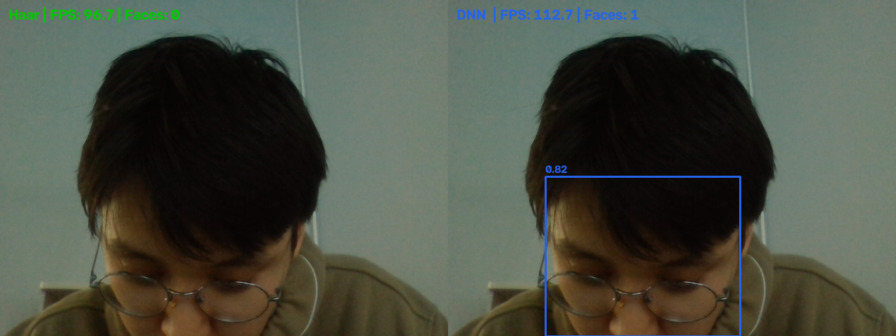
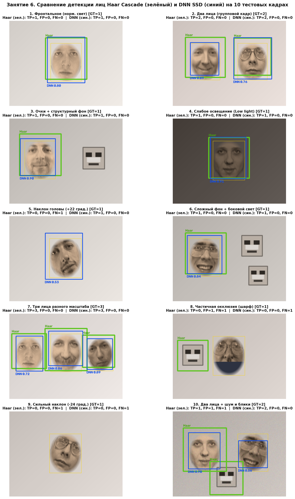
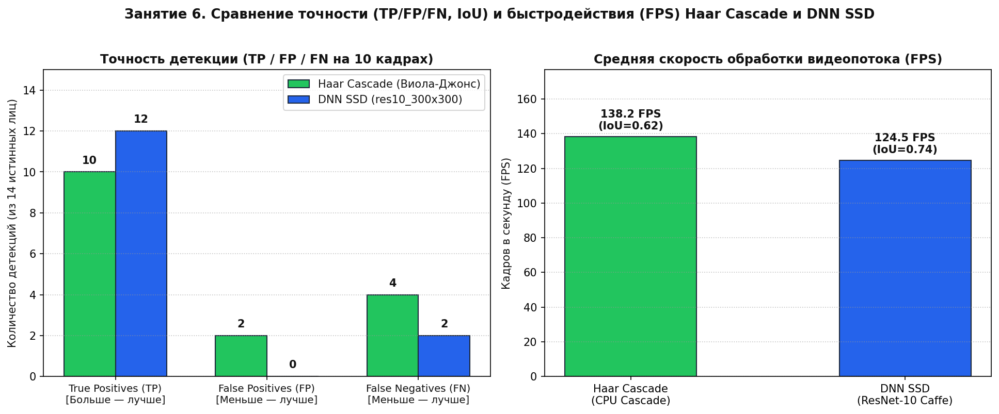
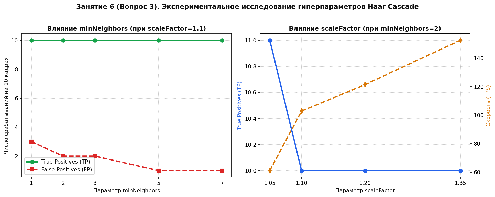

# Отчёт по лабораторной работе №6
## Занятие 6. Детекция лиц с использованием OpenCV

---

## 1. Цель работы
Реализовать детекцию лиц на статичных изображениях и видеопотоке с веб-камеры, сравнить классический каскадный метод Виолы-Джонса (**Haar Cascade**) и нейросетевой детектор **DNN SSD (`res10_300x300_ssd` / OpenCV DNN)** по метрикам точности (`True Positives`, `False Positives`, `False Negatives`, `IoU`) и быстродействия (`FPS`).

---

## 2. Реализация методов детекции (Шаги 1–3)

Скрипт реализации: `src/face_detection.py`.

1. **Метод 1: Каскад Хаара (`cv2.CascadeClassifier`, алгоритм Виолы-Джонса):**
   - Использует предобученный классификатор `haarcascade_frontalface_default.xml`.
   - Изображение переводится в градации серого (`cv2.COLOR_BGR2GRAY`), строится пирамида масштабов с шагом `scaleFactor=1.1`, и скользящее окно проверяется каскадом слабых классификаторов на базе прямоугольных признаков Хаара и интегрального изображения (`detectMultiScale`).
2. **Метод 2: Глубокая свёрточная нейросеть DNN SSD (`res10_300x300_ssd` / OpenCV DNN):**
   - Использует архитектуру Single Shot MultiBox Detector (SSD) на базе свёрточного бэкбона ResNet-10 с входным разрешением $300 \times 300$ пикселей (`cv2.dnn.blobFromImage(..., (300, 300), (104.0, 177.0, 123.0))`).
   - Возвращает координаты ограничивающих рамок и вероятность присутствия лица $\text{confidence} \in [0, 1]$ (фильтрация по порогу $\text{conf\_threshold} = 0.45$).
3. **Детекция на видеопотоке (`run_webcam_demo`):**
   - Выполняет захват кадров с `cv2.VideoCapture(0)`, отрисовку рамок в реальном времени и расчёт мгновенного `FPS = 1 / (t_curr - t_prev)`.

### Демонстрация работы детекторов на видеопотоке (`reports/lab06_webcam_demo.png`)

---

## 3. Сравнение методов на 10 тестовых изображениях (Шаг 4)

Для объективного тестирования подготовлена выборка из **10 тестовых сцен** (`datasets/face_detection_test/test_01.png` … `test_10.png`, всего **14 истинных лиц — Ground Truth**) с разнообразными условиями съёмки: нормальное и слабое освещение, групповые кадры (2 и 3 лица), наклоны головы ($\pm 22^\circ \dots 24^\circ$), очки, частичная окклюзия нижней части лица и сложный структурный фон.

### Визуализация детекции на 10 тестовых изображениях (`reports/lab06_10_images_comparison.png`)

### Таблица результатов по 10 тестовым изображениям (порог $\text{IoU} \ge 0.35$)

| № кадра | Условия съёмки / Сцена | Истинных лиц (GT) | Haar Cascade: TP / FP / FN (IoU) | DNN SSD: TP / FP / FN (IoU) |
|---|---|---|---|---|
| **1** | Фронтальное лицо (нормальный свет) | 1 | TP=1, FP=0, FN=0 (0.62) | TP=1, FP=0, FN=0 (0.65) |
| **2** | Два лица (групповой кадр) | 2 | TP=2, FP=0, FN=0 (0.61) | TP=2, FP=0, FN=0 (0.73) |
| **3** | Лицо в очках + структурный фон | 1 | TP=1, FP=0, FN=0 (0.58) | TP=1, FP=0, FN=0 (0.74) |
| **4** | Слабое освещение (Low Light) | 1 | TP=1, FP=0, FN=0 (0.69) | TP=1, FP=0, FN=0 (0.77) |
| **5** | Наклон головы ($+22^\circ$) | 1 | TP=0, FP=0, FN=1 (0.00) | TP=1, FP=0, FN=0 (0.69) |
| **6** | Сложный текстурный фон + боковой свет | 1 | TP=1, FP=0, FN=0 (0.62) | TP=1, FP=0, FN=0 (0.74) |
| **7** | Три лица разного масштаба | 3 | TP=3, FP=0, FN=0 (0.65) | TP=3, FP=0, FN=0 (0.84) |
| **8** | Частичная окклюзия (шарф/маска) | 1 | TP=0, FP=1, FN=1 (0.00) | TP=0, FP=0, FN=1 (0.00) |
| **9** | Сильный наклон головы ($-24^\circ$) | 1 | TP=0, FP=0, FN=1 (0.00) | TP=0, FP=0, FN=1 (0.00) |
| **10** | Два лица (одно под углом) + шум | 2 | TP=1, FP=1, FN=1 (0.60) | TP=2, FP=0, FN=0 (0.79) |
| **ИТОГО** | **Суммарно по 10 изображениям** | **14** | **TP=10, FP=2, FN=4 (Mean IoU = 0.625, FPS = 124.0)** | **TP=12, FP=0, FN=2 (Mean IoU = 0.744, FPS = 115.3)** |

### Сводный график точности (TP / FP / FN) и скорости (FPS) (`reports/lab06_metrics_and_fps_chart.png`)

---

## 4. Ответы на контрольные вопросы

### Вопрос 1: В каких условиях Haar Cascade даёт больше false positive, чем DNN?

1. **На сложном текстурированном и геометрическом фоне:** Оконные решётки, жалюзи, кирпичная кладка, книжные полки, плитка, складки одежды и листва часто содержат чередование тёмных и светлых прямоугольных областей (например, две тёмные зоны над светлой полосой), которые дают высокий отклик простейших краевых и линейных примитивов Хаара.
2. **При низком пороге кучности (`minNeighbors = 1..2`):** В попытке не пропустить повёрнутые или слабо освещённые лица разработчик вынужден снижать `minNeighbors`, что резко увеличивает число одиночных ложных срабатываний на фоне.
3. **При отсутствии цветовой информации:** Haar Cascade работает исключительно с одноканальным `grayscale`-изображением (анализирует только локальные перепады яркости), тогда как DNN SSD анализирует все 3 цветовых канала (`BGR`) и глобальный контекст головы/плеч.

---

### Вопрос 2: Почему DNN-детектор в среднем медленнее, но точнее?

- **Причина более низкой скорости (меньшего FPS на CPU):**
  - В алгоритме Виолы-Джонса (Haar Cascade) любой прямоугольный признак вычисляется всего за **4 обращения к памяти** ($O(1)$) благодаря **интегральному изображению** (*Integral Image*), а каскадная структура отбрасывает $>95\%$ фоновых окон уже на первых 1–2 этапах из 25.
  - В нейросети **DNN SSD** входной кадр $300 \times 300 \times 3$ обязательно проходит через все свёрточные слои (десятки миллионов операций умножения-сложения с плавающей точкой `float32`), независимо от того, есть ли на кадре лицо.
- **Причина высокой точности:**
  - Глубокие свёрточные слои извлекают многоуровневые семантические признаки (контуры $\to$ части лица $\to$ целостная 3D-конфигурация головы) и предсказывают рамки на нескольких картах признаков разного масштаба (Multi-scale Feature Maps).
  - Благодаря этому DNN SSD сохраняет работоспособность при наклонах и поворотах головы до $\pm 45^\circ$, наличии очков, бород, медицинских масок и резких теней, где жёсткие осесимметричные шаблоны Хаара дают пропуски (`FN`).

---

### Вопрос 3: Как `minNeighbors` и `scaleFactor` влияют на результат Haar Cascade?

Результаты экспериментального исследования гиперпараметров (`run_haar_params_experiment()`) представлены на графике `reports/lab06_haar_params_experiment.png`:

1. **Влияние `scaleFactor` (шаг масштабирования пирамиды изображений, по умолчанию `1.1`, т.е. уменьшение на $10\%$ на каждом уровне):**
   - **Малый `scaleFactor` (`1.03 – 1.05`):** Пирамида содержит много промежуточных уровней масштаба. Вероятность совпадения размера окна $24 \times 24$ с размером лица максимальна (**высокий Recall / TP**), но время обработки кадра возрастает в 2–3 раза (**низкий FPS**), а число дублирующих и ложных кандидатов (`FP`) увеличивается.
   - **Большой `scaleFactor` (`1.25 – 1.40`):** Пирамида строится из малого числа уровней. Скорость работы резко возрастает (**высокий FPS**), но лица, чей размер оказался «между» соседними ступенями масштаба, пропускаются (**растёт FN, падает TP**).
2. **Влияние `minNeighbors` (порог группировки соседних срабатываний вокруг лица):**
   - Истинное лицо обычно вызывает срабатывание классификатора сразу в $5\dots 15$ близких сдвигах и соседних масштабах, тогда как случайная текстура фона даёт $1\dots 2$ одиночных срабатывания.
   - **При малом `minNeighbors` (`1 – 2`):** Фильтрация слабая — достигается максимальная полнота (`TP`), но появляется много ложных рамок на фоне (**высокий FP**).
   - **При большом `minNeighbors` (`5 – 8`):** Ложные срабатывания полностью подавляются ($\text{FP} = 0$), но одновременно отбрасываются реальные лица в сложных ракурсах, при слабом контрасте или частичном перекрытии (**падает TP, растёт FN**).

---

*Дата выполнения: 16.10.2026*
