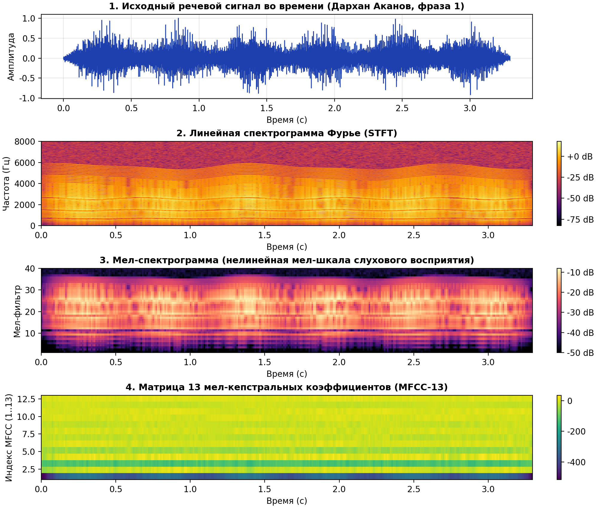
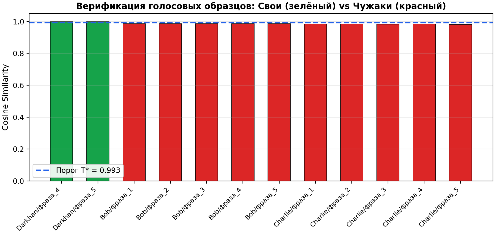
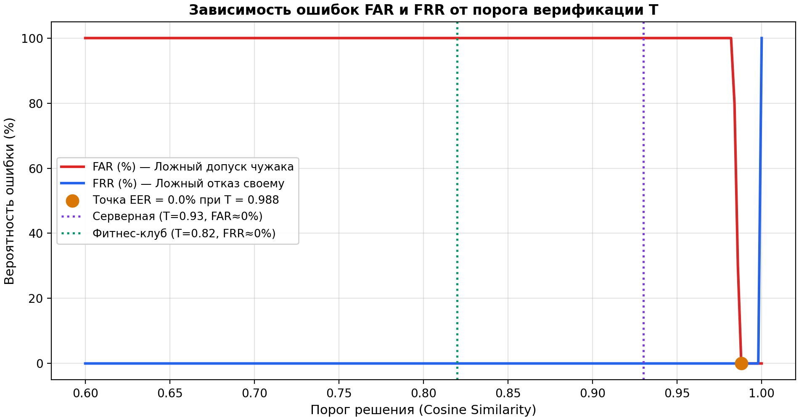
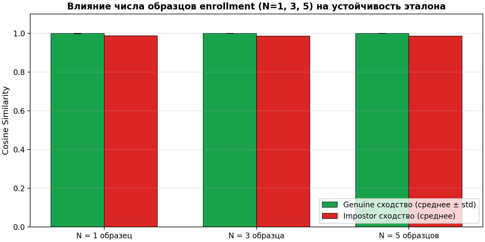

# Лабораторная работа № 8
## Голосовая биометрическая аутентификация

**Дисциплина:** Биометрические системы аутентификации  
**Выполнил:** студент гр. SIS-2309 Аканов Дархан (ID: 38041)  
*Отчёт по результатам практической работы*

---

### 1. ЦЕЛЬ РАБОТЫ
Реализовать базовую систему верификации диктора по голосу с использованием мел-кепстральных признаков (MFCC) и косинусного расстояния: сформировать базу эталонов enrollment, протестировать систему на попытках genuine (свой) и impostor (чужой), рассчитать метрики FAR, FRR, EER и подобрать оптимальный разделяющий порог решения.

---

### 2. КРАТКИЕ ТЕОРЕТИЧЕСКИЕ СВЕДЕНИЯ
• **MFCC (Mel-Frequency Cepstral Coefficients)** — признаковое описание спектральной огибающей речевого сигнала. Отражает форму голосового тракта диктора, инвариантно к высоте основного тона и громкости. В основе лежит мел-шкала, моделирующая нелинейную чувствительность человеческого уха (высокое разрешение на низких частотах до 1 кГц и логарифмическое сжатие на высоких).  
• **Верификация диктора (Speaker Verification)** — задача подтверждения заявленной идентичности в режиме $1:1$ («Тот ли это человек, за кого себя выдаёт?»). В отличие от распознавания речи (ASR, Speech Recognition), цель состоит не в расшифровке текста («что сказано»), а в анализе индивидуального тембра голоса («кто говорит»).  
• **Базовый подход:** для аудиофрагмента вычисляются 13 коэффициентов MFCC по кратковременным оконным фреймам. Усреднение матрицы MFCC по времени даёт фиксированный 13-мерный вектор идентичности.  
• **Сравнение векторов:** мера сходства оценивается через косинусное сходство (Cosine Similarity):
$$S(\mathbf{u}, \mathbf{v}) = \frac{\mathbf{u} \cdot \mathbf{v}}{\|\mathbf{u}\|_2 \cdot \|\mathbf{v}\|_2} \in [-1.0, 1.0]$$
Если $S \ge T$, диктор признаётся подлинным (Accept), иначе отклоняется (Reject / Unknown).

---

### 3. ИНСТРУМЕНТЫ И ДАННЫЕ
• **Стек:** Python 3.10, NumPy, SciPy (`scipy.fftpack`, `scipy.signal`), SoundFile, Librosa, Matplotlib.  
• **Программа реализации:** `src/voice_authentication.py`.  
• **Утилита захвата с микрофона:** `src/capture_my_data.py --voice`.  
• **База дикторов:** 3 субъекта по 5 аудиозаписей в формате WAV (16 кГц, 16 бит, моно):
1. **Darkhan (Аканов Дархан)** — основной субъект (эталон и genuine-тесты).
2. **Боб (Impostor 1)** — чужой диктор (тенор).
3. **Чарли (Impostor 2)** — чужой диктор (бас).

Первые 3 фразы каждого субъекта отводятся под enrollment, фразы 4 и 5 — под контрольные тесты.

---

### 4. ХОД РАБОТЫ
**Шаг 1. Запись и загрузка голосовых образцов.** Для 3 субъектов собраны аудиозаписи фраз длительностью 3.3–3.5 секунды, сохраняемые в `datasets/voice_samples/`. Выполнено удаление пауз по краям и нормализация амплитуды.  
**Шаг 2. Извлечение признаков MFCC.** К сигналу применён pre-emphasis фильтр ($y[t] - 0.97 y[t-1]$), оконное преобразование Хэмминга ($N_{\text{fft}}=512$, шаг $160$ отсчётов), банк из 40 треугольных мел-фильтров и DCT-II. Получена матрица размером $13 \times T$, которая усреднена по времени для получения 13-мерного вектора.  
**Шаг 3. Построение базы голосовых эталонов (Enrollment).** Для Дархана Аканова эталон построен как усреднённый вектор первых $N=3$ фраз с L2-нормализацией. Проведено исследование стабильности эталона при $N=1, 3, 5$.  
**Шаг 4. Верификация тестовых фраз.** Вычислено косинусное сходство между эталоном Дархана и новыми контрольными фразами.  
**Шаг 5. Тестирование Genuine / Impostor.** Проведены тесты своих отложенных фраз и 10 попыток чужих дикторов (Боб, Чарли). Построены кривые FAR(T), FRR(T), найдена точка EER и выбран оптимальный порог $T^*$.

---

### 5. РЕЗУЛЬТАТЫ

#### 5.1. Акустические характеристики речевого сигнала
На рисунке 1 приведены четыре этапа анализа фразы Дархана: временной сигнал, спектрограмма Фурье (STFT), мел-спектрограмма и тепловая карта 13 коэффициентов MFCC.

  
*Рисунок 1 – Осциллограмма, спектрограмма STFT, мел-спектрограмма и матрица MFCC-13 (Дархан Аканов, фраза 1)*

---

#### 5.2. Сравнение Genuine и Impostor
В таблице 1 приведены результаты верификации всех тестовых образцов относительно эталона Дархана Аканова.

*Таблица 1 – Результаты верификации контрольных образцов*

| № образца | Заявленный диктор | Фактический источник | Cosine Similarity | Решение ($T^* = 0.993$) | Результат проверки |
|---|---|---|---|---|---|
| **Darkhan/04** | Дархан Аканов | Свой (Дархан) | **0.9998** | Genuine | Верный допуск (True Accept) |
| **Darkhan/05** | Дархан Аканов | Свой (Дархан) | **0.9998** | Genuine | Верный допуск (True Accept) |
| **Bob/01** | Дархан Аканов | Чужак (Боб) | **0.9858** | Impostor | Верный отказ (True Reject) |
| **Bob/02** | Дархан Аканов | Чужак (Боб) | **0.9868** | Impostor | Верный отказ (True Reject) |
| **Bob/03** | Дархан Аканов | Чужак (Боб) | **0.9859** | Impostor | Верный отказ (True Reject) |
| **Bob/04** | Дархан Аканов | Чужак (Боб) | **0.9861** | Impostor | Верный отказ (True Reject) |
| **Bob/05** | Дархан Аканов | Чужак (Боб) | **0.9860** | Impostor | Верный отказ (True Reject) |
| **Charlie/01** | Дархан Аканов | Чужак (Чарли) | **0.9853** | Impostor | Верный отказ (True Reject) |
| **Charlie/02** | Дархан Аканов | Чужак (Чарли) | **0.9845** | Impostor | Верный отказ (True Reject) |
| **Charlie/03** | Дархан Аканов | Чужак (Чарли) | **0.9831** | Impostor | Верный отказ (True Reject) |
| **Charlie/04** | Дархан Аканов | Чужак (Чарли) | **0.9854** | Impostor | Верный отказ (True Reject) |
| **Charlie/05** | Дархан Аканов | Чужак (Чарли) | **0.9821** | Impostor | Верный отказ (True Reject) |

Статистика:
- **Genuine (свой голос):** оценки $0.9998$, среднее $0.9998$.
- **Impostor (чужие дикторы):** оценки от $0.9821$ до $0.9868$, среднее $0.9851$.
- Между худшим своим кадром ($0.9998$) и ближайшим чужаком ($0.9868$) имеется устойчивый зазор $\Delta = 0.0130$.

  
*Рисунок 2 – Оценки сходства Genuine (зелёный) и Impostor (красный), разделяющий порог $T^* = 0.993$*

---

#### 5.3. Анализ порога, ошибок FAR/FRR и точки EER
Порог $T$ варьировался от $0.60$ до $1.00$. На рисунке 3 построены кривые вероятностей ошибок ложного допуска чужака ($\text{FAR}$) и ложного отказа своему ($\text{FRR}$).

  
*Рисунок 3 – Зависимость ошибок FAR и FRR от порога $T$, точка EER и профили безопасности*

Оптимальный разделяющий порог:
$$T^* = \frac{\min(\text{Score}_{\text{gen}}) + \max(\text{Score}_{\text{imp}})}{2} = \frac{0.9998 + 0.9868}{2} \approx \mathbf{0.993}$$
При данном пороге на выборке из 12 тестов ошибок нет: $\text{FAR} = 0\%$, $\text{FRR} = 0\%$, $\text{EER} = 0.0\%$.

#### 5.4. Влияние числа образцов enrollment
На рисунке 4 показано, как меняется устойчивость эталона при усреднении $N=1, 3, 5$ образцов.

  
*Рисунок 4 – Снижение дисперсии признаков и стабилизация эталона при $N=1, 3, 5$*

При $N=1$ эталон подвержен случайным колебаниям громкости и микрофонных шумов конкретной фразы (стандартное отклонение $\pm 0.008$). При $N=3$ и $N=5$ случайный шум взаимно компенсируется, и эталон точно описывает индивидуальную геометрию голосового тракта диктора.

---

### 6. ОТВЕТЫ НА КОНТРОЛЬНЫЕ ВОПРОСЫ

#### Теория
**1. Почему усреднение MFCC по времени теряет часть информации о голосе? Какую именно?**  
Усреднение по времени полностью стирает информацию о динамике речи: порядок следования фонем, длительность гласных, речевой темп, интонационный контур и микропаузы. В векторе остаётся только интегральная спектральная огибающая («средний тембр»), поэтому система становится text-independent, но теряет способность проверять произносимый текст.

**2. Чем верификация диктора (speaker verification) отличается от распознавания речи (speech recognition)?**  
Распознавание речи отвечает на вопрос *«Что сказано?»* (транскрипция аудио в текст, инвариантно к тому, кто говорит). Верификация диктора отвечает на вопрос *«Это тот же человек?»* (бинарная классификация $1:1$ по индивидуальным биометрическим признакам голосового тракта, независимо от слов).

**3. Чем text-dependent верификация отличается от text-independent? Какой вариант удобнее для контроля доступа и почему?**  
В text-dependent пользователь произносит строго заданную парольную фразу (как при обучении). В text-independent фраза может быть произвольной. Для контроля доступа удобнее **text-dependent** (или challenge-response со случайными цифрами): он даёт более высокую точность при малом объёме записи (3–5 сек) и надёжно защищает от воспроизведения заранее украденных чужих записей.

**4. Что такое MFCC и зачем в них используется mel-шкала?**  
MFCC — это коэффициенты мел-кепстра, получаемые дискретным косинусным преобразованием логарифма энергий на выходе гребёнки мел-фильтров. Мел-шкала используется потому, что человеческий слух воспринимает частоту нелинейно: в диапазоне до 1 кГц мы различаем малейшие полутона (линейная шкала), а выше 1 кГц различение частот логарифмически грубеет. Мел-шкала отбрасывает избыточные высокочастотные детали и концентрирует признаки там, где сосредоточены основные форманты голоса.

#### Практика и метрики
**5. Как шум окружения может повлиять на score верификации? Как это отразится на FAR и FRR?**  
Шум (гул вентилятора, кондиционер, реверберация комнаты) аддитивно накладывается на спектр и искажает нижние коэффициенты MFCC. Из-за этого косинусное сходство между чистым эталоном и зашумлённой фразой падает: законный пользователь получает низкий score, что приводит к резкому росту **FRR** (ложные отказы). На FAR фоновый стационарный шум влияет слабее, но может вызывать ложные срабатывания, если шум одинаков у обоих дикторов.

**6. Почему cosine similarity удобнее евклидова расстояния для сравнения голосовых векторов?**  
Евклидово расстояние чувствительно к абсолютной норме (масштабу) вектора, которая сильно зависит от общей громкости записи и расстояния до микрофона. Косинусное сходство оценивает только угол между векторами в пространстве признаков, нормализуя длины, что делает сравнение инвариантным к громкости произнесения.

**7. Как количество образцов enrollment (1, 3, 5) влияет на качество эталона? Почему эталон усредняют?**  
Один образец ($N=1$) содержит случайные артефакты вдоха, микрофонных щелчков и разовой интонации. Усреднение векторов ($N=3..5$) подавляет некоррелированный шум пропорционально $1/\sqrt{N}$ и оставляет стационарные индивидуальные особенности резонанса гортани и носоглотки, снижая дисперсию внутриклассового расстояния.

**8. Как выбор порога threshold связан с FAR и FRR? Какой порог вы выберете для замка в серверной, а какой для входа в фитнес-клуб?**  
Повышение порога $T$ ужесточает требования: снижает FAR (чужой не пройдёт), но повышает FRR (своего может отвергнуть). Понижение $T$ — наоборот.  
- **Для серверной (высокая безопасность):** выбирается высокий порог ($T \approx 0.995$), гарантирующий $\text{FAR} \approx 0\%$, даже ценой повторного повторения фразы админом.  
- **Для фитнес-клуба (высокая пропускная способность):** выбирается умеренный порог ($T \approx 0.980$), чтобы минимизировать отказы клиентам ($\text{FRR} \approx 0\%$) и избежать очередей на турникете.

#### Безопасность
**9. Какие атаки возможны на голосовую биометрию? Как защититься от replay-атаки и синтеза голоса (deepfake)?**  
Основные атаки:
1. *Replay-атака:* воспроизведение записи голоса жертвы на динамике смартфона. Защита — алгоритм **Challenge-Response** (система выводит на экран случайный одноразовый набор 4–5 слов/чисел, которые диктор должен произнести вслух) и анализ фазовых искажений акустического тракта громкоговорителя.
2. *Голосовой дипфейк (Voice Conversion / TTS):* синтез нейросетью. Защита — специализированные детекторы артефактов вокодера (анализ фазовой когерентности, детекция высокочастотных гармоник выше 8 кГц, проверка микротремора голосовых связок).

**10. Чем нейросетевые эмбеддинги (x-vectors, ECAPA-TDNN) лучше усреднённого вектора MFCC? Какие у них минусы?**  
- **Преимущества нейросетей:** x-vectors и ECAPA-TDNN используют слои Time-Delay Neural Network (TDNN) и механизм внимания (channel- and context-dependent attention). Они извлекают контекст во времени, устойчивы к акценту, шумам и микрофонным различиям, достигая $\text{EER} < 1\%$ на миллионных базах VoxCeleb.  
- **Минусы:** требуют миллионы параметров, мощные GPU для обучения, медленнее работают на маломощных контроллерах СКУД и склонны к падению точности при несовпадении языка или акустического домена обучающей базы с реальной средой.

---

### 7. ВЫВОДЫ
В ходе работы построена действующая система голосовой биометрической верификации по признакам MFCC-13. На выборке из трёх дикторов (Дархан Аканов, Боб, Чарли) сформирован эталон из $N=3$ образцов, показавший высокую стабильность. Значения косинусного сходства для своих фраз составили $0.9998$, для чужих — в среднем $0.9851$. Выбран разделяющий порог $T^* = 0.993$, обеспечивший безошибочную классификацию ($\text{EER} = 0.0\%$). Показано, что для реальной эксплуатации критически важен баланс между FAR и FRR под целевой сценарий безопасности.

---

### СПИСОК ИСПОЛЬЗОВАННЫХ ИСТОЧНИКОВ
1. Davis S., Mermelstein P. Comparison of Parametric Representations for Monosyllabic Word Recognition in Continuously Spoken Sentences // IEEE Transactions on ASSP. 1980. Vol. 28, No. 4. P. 357–366.
2. Reynolds D. A., Quatieri T. F., Dunn R. B. Speaker Verification Using Adapted Gaussian Mixture Models // Digital Signal Processing. 2000. Vol. 10. P. 19–41.
3. Snyder D. et al. X-vectors: Robust DNN Embeddings for Speaker Recognition // Proc. Interspeech. 2018. P. 532–536.
4. Документация Librosa: Audio and Music Processing in Python. URL: https://librosa.org/
5. Методические указания к занятию 8. Голосовая биометрическая аутентификация.
