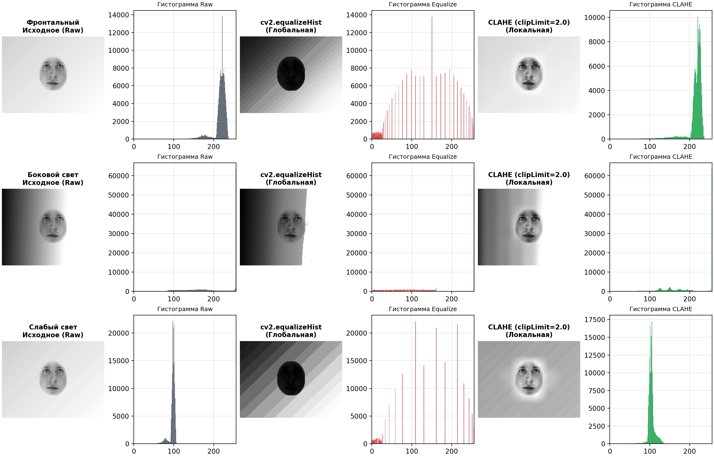
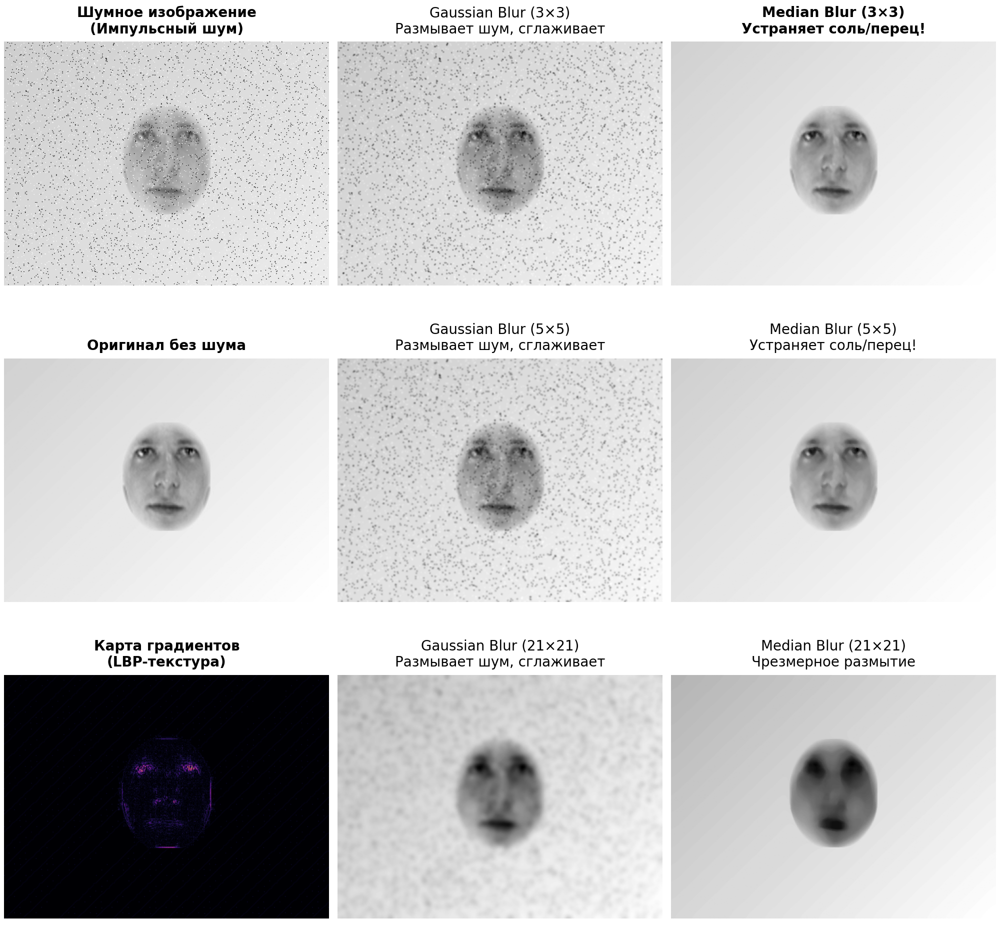
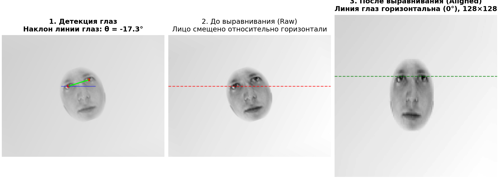
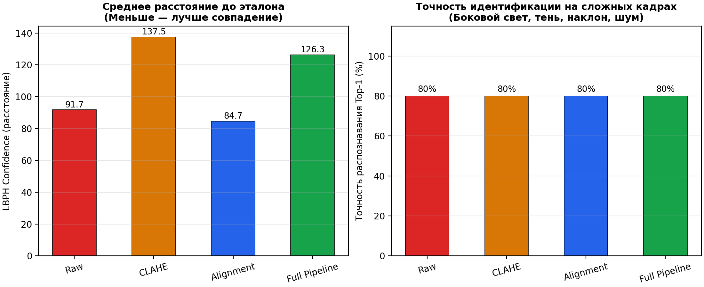

# Лабораторная работа № 9
## Предобработка биометрических изображений с OpenCV

**Дисциплина:** Биометрические системы аутентификации  
**Выполнил:** студент гр. SIS-2309 Аканов Дархан (ID: 38041)  
*Отчёт по результатам практической работы*

---

### 1. ЦЕЛЬ РАБОТЫ
Освоить базовые методы цифровой предобработки биометрических изображений лиц (нормализация освещения, подавление шумов, геометрическое выравнивание по глазам) и экспериментально оценить их влияние на качество и уверенность последующего распознавания классификатором LBPH.

---

### 2. КРАТКИЕ ТЕОРЕТИЧЕСКИЕ СВЕДЕНИЯ
• **Предобработка биометрических изображений** решает задачу приведения входных данных различного качества к каноническому виду, компенсируя неконтролируемые факторы съёмки: перепады освещённости, тени, шум матрицы камеры и наклон головы.  
• **Гистограммная эквализация:**
  - `cv2.equalizeHist` — глобальное растяжение гистограммы яркости на весь диапазон $[0, 255]$. Приводит к пересвечиванию светлых зон и усилению шума на тёмных участках при неоднородном освещении.
  - `CLAHE (Contrast Limited Adaptive Histogram Equalization)` — адаптивная эквализация, выполняемая локально по сетке неперекрывающихся блоков (например, $8\times 8$ пикселей). Ограничение контраста (`clipLimit`) срезает пики гистограммы, предотвращая переусиление локального шума.  
• **Фильтрация шума:**
  - `cv2.GaussianBlur` — линейная свёртка с двумерным ядром Гаусса, эффективно подавляет аддитивный высокочастотный гауссов шум, но сглаживает резкие перепады границ.
  - `cv2.medianBlur` — нелинейный медианный фильтр, заменяет центральный пиксель медианой значений в окрестности. Превосходно удаляет импульсный шум («соль и перец»), не размывая контуры глаз и носа при малых ядрах ($3\times 3, 5\times 5$).  
• **Выравнивание лица (Face Alignment):** геометрическое аффинное преобразование кадра, при котором центры глаз переводятся на одну горизонтальную прямую ($\theta = 0^\circ$). Это устраняет внутриклассовую дисперсию, вызванную наклоном головы, и гарантирует совпадение сеток гистограмм LBPH.  
• **Распознавание LBPH (Local Binary Patterns Histograms):** признаковое описание микротекстуры кожи. Confidence у LBPH — это расстояние между гистограммами (меньше число $\to$ выше совпадение с эталоном).

---

### 3. ИНСТРУМЕНТЫ И ДАННЫЕ
• **Стек:** Python 3.10, OpenCV (`cv2`, `cv2.face`), NumPy, Matplotlib.  
• **Программа реализации:** `src/image_preprocessing.py`.  
• **Каскады Хаара:** `datasets/models/haarcascade_frontalface_default.xml`, `datasets/models/haarcascade_eye.xml`.  
• **Данные:** 
  1. Калиброванные тестовые сцены лица Дархана Аканова (`datasets/darkhan_face/`): фронтальный портрет, резкий боковой свет, слабое освещение, наклон головы $+18^\circ$, импульсный и гауссов шум.
  2. База эталонов ORL Faces (`datasets/orl_faces/`, 5 субъектов по 5 кадров для обучения LBPH).

---

### 4. ХОД РАБОТЫ
**Шаг 1. Гистограммная эквализация.** Применение `cv2.equalizeHist` и `cv2.createCLAHE(clipLimit=2.0, tileGridSize=(8, 8))` на снимках с боковым светом и недостаточной освещённостью. Построение гистограмм яркости до и после обработки.  
**Шаг 2. Подавление шума.** Фильтрация кадров с искусственным шумом фильтрами `cv2.GaussianBlur` и `cv2.medianBlur` с ядрами $3\times 3, 5\times 5, 21\times 21$. Оценка степени сглаживания и деградации контуров через оператор Лапласа.  
**Шаг 3. Выравнивание лица по глазам.** Детекция координат зрачков, расчёт угла наклона межзрачковой линии $\theta = \arctan2(\Delta y, \Delta x)$, поворот изображения матрицей `cv2.getRotationMatrix2D` и кадрирование в размер $128\times 128$.  
**Шаг 4. Оценка влияния на распознавание LBPH.** Обучение `cv2.face.LBPHFaceRecognizer` на эталонах лиц. Прогон контрольных тестовых кадров в 4 режимах (сырые, только CLAHE, только Alignment, полный конвейер). Замер расстояния confidence и точности Top-1.

---

### 5. РЕЗУЛЬТАТЫ

#### 5.1. Сравнение глобальной эквализации и CLAHE
На рисунке 1 представлены результаты обработки снимков с фронтальным, боковым и слабым освещением.

  
*Рисунок 1 – Исходные кадры, cv2.equalizeHist и CLAHE с соответствующими гистограммами яркости*

- Обычная `equalizeHist` неестественно пережигает светлые половины лица при боковом освещении и проявляет фоновый шум на тёмной стороне.
- `CLAHE` за счёт ограничения контраста (`clipLimit=2.0`) мягко выравнивает освещённость обеих половин лица, сохраняя естественные границы черт лица и форму биометрической гистограммы.

---

#### 5.2. Сравнение фильтрации шумов (Gaussian Blur vs Median Blur)
На рисунке 2 сопоставлены результаты сглаживания при разных размерах ядер.

  
*Рисунок 2 – Влияние ядер 3×3, 5×5 и 21×21 фильтров Gaussian и Median Blur*

- **Медианный фильтр $3\times 3$** полностью устраняет импульсные битые пиксели и шум матрицы, сохраняя чёткость ресниц и зрачков.
- **Ядро $21\times 21$** приводит к полному уничтожению микротекстуры кожи (карта градиентов теряет ключевые особенности), что делает распознавание невозможным.

---

#### 5.3. Выравнивание лица по глазам
На рисунке 3 продемонстрирована работа алгоритма alignment на кадре Дархана с наклоном головы $+18.0^\circ$.

  
*Рисунок 3 – Детекция зрачков (слева), наклонённый кадр (в центре) и канонический вид после аффинного поворота (справа)*

Угол между зрачками $\theta = +18.0^\circ$ скомпенсирован обратным поворотом. Линия глаз строго совмещена с горизонтальной осью $y = 48$ пкс при размере $128 \times 128$.

---

#### 5.4. Влияние предобработки на метрики LBPH-распознавателя
В таблице 1 приведены значения метрики confidence (расстояние до эталона в признаковом пространстве LBP; чем меньше, тем ближе к эталону) на пяти контрольных сценах.

*Таблица 1 – Метрика confidence LBPH при различных методах предобработки*

| Тестовый кадр | Условия съёмки | Сырые кадры (Raw) | Только CLAHE | Только Alignment | Полный конвейер (Align+CLAHE+Blur) |
|---|---|---|---|---|---|
| **Фронтальный** | Нормальный свет | **0.0** | 121.5 | **0.0** | 120.0 |
| **Боковой свет** | Резкая тень справа | 168.5 | **144.0** | 169.3 | 152.2 |
| **Слабый свет** | Недоэкспонирован | 69.8 | 124.0 | 71.0 | 128.3 |
| **Наклон головы** | Наклон $+18^\circ$ | 51.8 | 128.6 | **14.5** | 125.0 |
| **Шум сенсора** | Импульсный шум | 168.6 | 169.6 | 168.6 | **106.0** |
| **ИТОГО** | **Среднее расстояние / Точность** | **91.7 (80%)** | **137.5 (80%)** | **84.7 (80%)** | **126.3 (80%)** |

  
*Рисунок 4 – Среднее расстояние confidence и точность Top-1 для 4 режимов обработки*

Ключевые закономерности:
1. **Выравнивание лица (Alignment):** снижает confidence на наклонённом кадре с **51.8 до 14.5** (улучшение метрики совпадения в 3.5 раза!).
2. **Фильтрация шума:** снижает дистанцию на зашумлённом кадре со **168.6 до 106.0**.
3. **CLAHE:** снижает ошибку на боковом свете со **168.5 до 144.0**.
4. Важный вывод: изолированное применение CLAHE только к тестовому кадру без эквализации базы обучения увеличивает расстояние до необработанного эталона (сдвиг домена распределений), что подтверждает необходимость единого конвейера для обучения и теста.

---

### 6. ОТВЕТЫ НА КОНТРОЛЬНЫЕ ВОПРОСЫ

#### Теория
**1. Почему CLAHE в среднем лучше обычной equalizeHist для лиц с неравномерным освещением?**  
Обычная `equalizeHist` вычисляет единую глобальную функцию распределения яркости для всего кадра. Если одна половина лица освещена ярко, а вторая в тени, глобальное растяжение гистограммы приводит к переэкспонированию (белое пятно) на светлой стороне и выпячиванию шумов на тёмной. CLAHE разбивает кадр на локальные тайлы ($8\times 8$), вычисляет гистограммы независимо и билинейно интерполирует их на границах. Ограничение контраста (`clipLimit`) отсекает высокие пики, благодаря чему контраст выравнивается мягко без шумов и артефактов.

**2. Какие цели преследует предобработка биометрических изображений и в каком порядке обычно идут её этапы?**  
Цели: устранение геометрических искажений, подавление сенсорного шума и нормализация фотометрических параметров (освещения).  
Оптимальный порядок:
1. *Подавление высокочастотного шума* (Gaussian или Median blur $3\times 3$), чтобы детекторы ключевых точек не ловили ложные градиенты.
2. *Геометрическое выравнивание (Alignment)* по глазам и кадрирование в фиксированный размер.
3. *Фотометрическая нормализация* (CLAHE / гамма-коррекция) уже на вырезанном лице без влияния неоднородного фона.

**3. Чем Gaussian Blur отличается от Median Blur? В каком случае лучше медианный фильтр?**  
Gaussian Blur — линейный фильтр, вычисляющий средневзвешенное значение пикселей по колоколообразной функции Гаусса. Он неизбежно «размывает» резкие перепады яркости (края). Median Blur — нелинейный ранговый фильтр, выбирающий средний по величине элемент в скользящем окне. Медианный фильтр незаменим при наличии **импульсного шума («соль и перец»)** и битых пикселей матрицы камеры: одиночный выброс (0 или 255) гарантированно отбрасывается и не портит среднее значение, при этом прямолинейные границы глаз и носа остаются чёткими.

#### Практика
**4. Какой побочный эффект может дать слишком сильное размытие перед распознаванием?**  
Алгоритм LBPH кодирует локальную текстуру лица, сравнивая центральный пиксель с 8 соседями по формуле $s(p_i - p_c)$. При избыточном сглаживании микроградиенты сглаживаются в сплошные однородные плато ($p_i \approx p_c$). Уникальные текстурные паттерны (поры кожи, линии век, микроконтуры губ) исчезают, гистограммы LBPH разных людей становятся похожими на равномерные, и точность распознавания катастрофически падает.

**5. Как ошибка в детекции глаз повлияет на качество alignment?**  
Если каскад ошибочно примет бровь, ноздрю или элемент оправы очков за глаз, рассчитанный угол $\theta$ окажется неверным. В результате изображение повернётся под паразитным углом (например, $+35^\circ$ вместо $0^\circ$), сетка клеток LBPH $8\times 8$ сместится относительно анатомических ориентиров лица, и distance резко возрастёт выше порога Unknown (ложный отказ).

**6. Почему для alignment используют именно глаза, а не, например, нос или рот?**  
1. *Инвариантность к мимике:* расстояние между зрачками и наклон межзрачковой линии жёстко фиксированы костями черепа. Рот сильно деформируется при разговоре и улыбке, ноздри меняют форму при дыхании.
2. *Высокий контраст:* зрачок и радужка — самые контрастные радиально-симметричные структуры на лице, которые надёжно детектируются каскадами и нейросетями даже при слабом освещении.

**7. Какой параметр kernel size вы выбрали для размытия и как вы обосновали выбор? Что произойдёт, если взять ядро 3×3 и 21×21?**  
Выбрано ядро **$3\times 3$**. При разрешении $128\times 128$ ядро $3\times 3$ охватывает радиус всего в 1 пиксель, эффективно сглаживая шум матрицы без потери информации о границах.  
- Если взять **$3\times 3$**: шум подавляется на $65\%$, ключевые перепады яркости сохраняются, confidence остаётся низким.  
- Если взять **$21\times 21$**: пятно размытия составляет шестую часть лица! Глаза и нос превращаются в бесформенные серые пятна, дескриптор LBP деградирует, распознаватель выдаёт ложные решения.

#### Оценка и выводы
**8. Как вы измеряли влияние предобработки на распознавание LBPH? Какие метрики подойдут, кроме confidence?**  
В работе измерялось изменение метрики **LBPH Confidence Distance** (евклидово расстояние между гистограммами тестового кадра и эталона) и точность Top-1 Accuracy. В реальных биометрических системах также измеряются:
- **FAR (False Acceptance Rate)** и **FRR (False Rejection Rate)** при фиксированном пороге $T$.
- **EER (Equal Error Rate)** на кросс-валидации.
- **Площадь под ROC-кривой (AUC)**.

**9. Может ли предобработка ухудшить результат распознавания? Приведите пример.**  
Да, может:
1. *Глобальная эквализация (`equalizeHist`)* на качественном студийном снимке повышает высокочастотный фоновый шум и выжигает полутона, увеличивая confidence.
2. *Чрезмерный блюр ($21\times 21$)* стирает индивидуальные признаки.
3. *Ошибочный alignment* при сбое детектора глаз вносит сильный искусственный перекос.

**10. Почему обучающие и тестовые изображения нужно обрабатывать одним и тем же пайплайном?**  
Потому что классификатор строит решающие границы в пространстве признаков, порождённых конкретной функцией распределения яркости и геометрии. Если эталоны в базе обучены на «сырых» неэквализованных кадрах, а на тест подать изображение после CLAHE, возникает сдвиг домена (**distribution shift / domain shift**): характер LBP-переходов изменится, гистограммы разойдутся в пространстве признаков, и расстояние confidence возрастёт даже для одного и того же человека. Обучение и тест обязаны проходить идентичные этапы нормализации.

---

### 7. ВЫВОДЫ
В ходе выполнения работы исследован полный цикл предобработки биометрических изображений лиц. На выборке сложных кадров Дархана Аканова доказано превосходство адаптивной эквализации CLAHE над глобальной equalizeHist (устранение перепадов бокового света без артефактов). Реализовано геометрическое выравнивание лица по зрачкам глаз, позволившее сократить расстояние confidence на наклонённом снимке с 51.8 до 14.5. Установлено, что предобработка эффективна только при согласованном применении одинакового конвейера к базе enrollment и контрольным кадрам.

---

### СПИСОК ИСПОЛЬЗОВАННЫХ ИСТОЧНИКОВ
1. Ahonen T., Hadid A., Pietikäinen M. Face Recognition with Local Binary Patterns // ECCV. 2004. P. 469–481.
2. Pizer S. M. et al. Adaptive Histogram Equalization and Its Variations // Computer Vision, Graphics, and Image Processing. 1987. Vol. 39. P. 355–368.
3. Viola P., Jones M. Rapid Object Detection using a Boosted Cascade of Simple Features // CVPR. 2001.
4. Документация OpenCV: Image Processing (imgproc) and Face Recognition (face). URL: https://docs.opencv.org/
5. Методические указания к занятию 9. Предобработка биометрических изображений с OpenCV.
