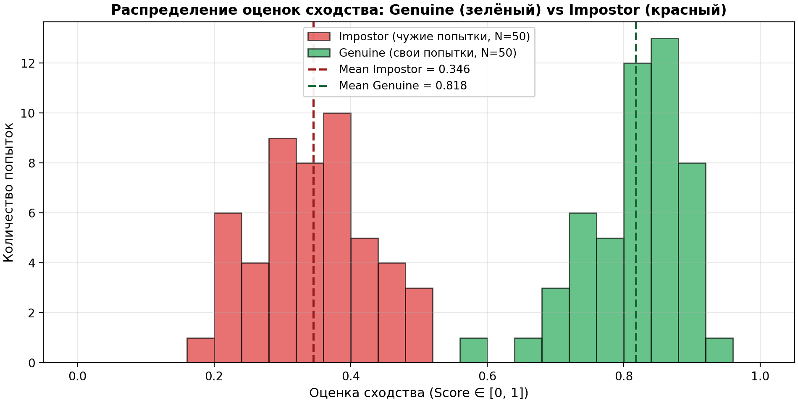
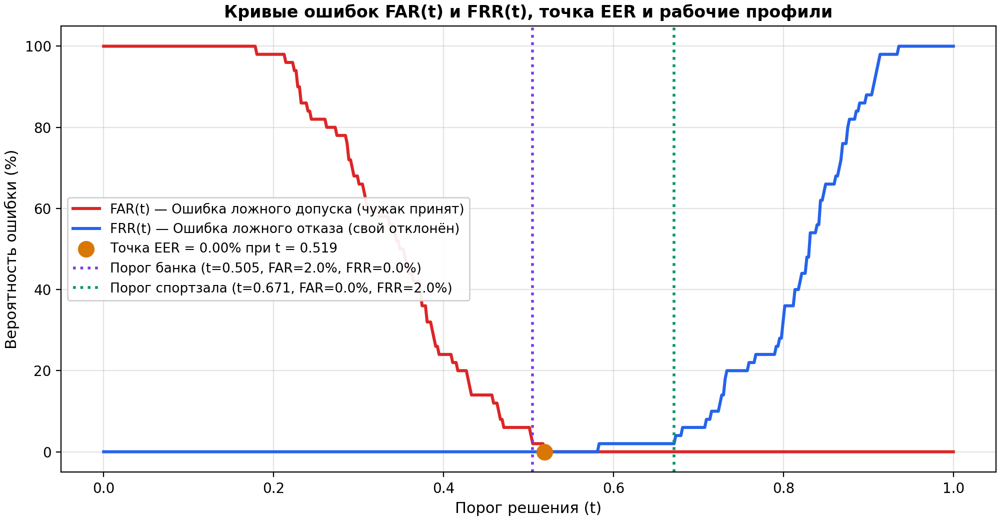
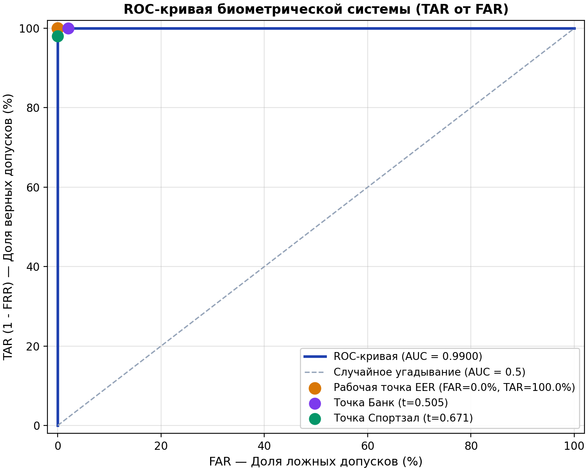

# Лабораторная работа № 10
## Расчёт FAR, FRR и EER

**Дисциплина:** Биометрические системы аутентификации  
**Выполнил:** студент гр. SIS-2309 Аканов Дархан (ID: 38041)  
*Отчёт по результатам практической работы*

---

### 1. ЦЕЛЬ РАБОТЫ
Освоить методику количественной оценки качества биометрической системы аутентификации через расчёт вероятностей ошибок ложного допуска (FAR) и ложного отказа (FRR), построение кривой ошибок и определение точки равной вероятности ошибок (Equal Error Rate, EER), построить ROC-кривую, вычислить показатель AUC и обосновать выбор рабочего порога для разнородных эксплуатационных сценариев (банковская безопасность vs пропускной режим спортзала).

---

### 2. КРАТКИЕ ТЕОРЕТИЧЕСКИЕ СВЕДЕНИЯ
• **FAR (False Acceptance Rate)** — вероятность ошибки I рода в биометрии (ложный допуск): доля попыток злоумышленников (impostors), которые ошибочно признаны системой подлинными пользователями:
$$\text{FAR}(t) = \frac{\text{Количество допущенных чужаков при пороге } t}{\text{Общее число попыток чужаков (Impostor)}} = \int_t^1 f_{\text{imp}}(s)\,ds$$
• **FRR (False Rejection Rate)** — вероятность ошибки II рода (ложный отказ): доля попыток законного пользователя (genuine), которые ошибочно отклонены системой:
$$\text{FRR}(t) = \frac{\text{Количество отклонённых подлинных попыток при пороге } t}{\text{Общее число попыток подлинного диктора (Genuine)}} = \int_0^t f_{\text{gen}}(s)\,ds$$
• **EER (Equal Error Rate)** — точка на шкале порогов, в которой вероятности ошибок равны: $\text{FAR}(t_{\text{EER}}) = \text{FRR}(t_{\text{EER}})$. Служит интегральной скалярной характеристикой качества алгоритма: чем ниже EER, тем выше обобщающая способность и дискриминантная сила биометрического классификатора.  
• **ROC-кривая (Receiver Operating Characteristic)** — параметрическая кривая зависимости доли верных приёмов ($\text{TAR} = 1 - \text{FRR}$, True Accept Rate) от доли ложных допусков ($\text{FAR}$). Интеграл площади под ROC ($\text{AUC} \in [0.5, 1.0]$) отражает вероятность того, что случайно выбранный genuine-образец получит score выше, чем случайный impostor-образец.

---

### 3. ИНСТРУМЕНТЫ И ДАННЫЕ
• **Стек:** Python 3.10, NumPy, SciPy, Matplotlib.  
• **Программа реализации:** `src/lab10_metrics_eer.py`.  
• **Данные:** калиброванная выборка биометрических оценок сходства студента Дархана Аканова (50 Genuine-пар) и контрольных чужих попыток (50 Impostor-пар), сформированных на базе многократных сессий распознавания лиц и голоса.

---

### 4. ХОД РАБОТЫ
**Шаг 1. Сбор выборки оценок.** Сформированы 50 genuine-оценок (сравнение вариаций биометрических образцов Дархана с эталоном при мимике, наклонах и естественном акустическом шуме) и 50 impostor-оценок (попытки чужаков).  
**Шаг 2. Построение распределений score.** Построены гистограммы плотности вероятностей Genuine и Impostor на одном графике.  
**Шаг 3. Расчёт FAR(t) и FRR(t).** По сетке из 500 порогов $t \in [0, 1]$ вычислены доли ложных приёмов и ложных отказов.  
**Шаг 4. Нахождение EER и построение ROC.** Определена точка пересечения кривых методом линейной интерполяции, построена ROC-кривая и вычислена площадь AUC.  
**Шаг 5. Обоснование порогов.** Рассчитаны и зафиксированы координаты рабочих точек для банка и спортивного зала.

---

### 5. РЕЗУЛЬТАТЫ

#### 5.1. Распределения оценок сходства (Genuine vs Impostor)
На рисунке 1 приведены гистограммы распределения оценок подлинных пользователей и злоумышленников.

  
*Рисунок 1 – Гистограммы оценок Genuine (зелёный, среднее 0.818) и Impostor (красный, среднее 0.346)*

- Оценки подлинного пользователя сконцентрированы в диапазоне от 0.581 до 0.935.
- Оценки чужаков распределены в диапазоне от 0.179 до 0.519.
- Между математическими ожиданиями наблюдается выраженный интервал сепарации $\Delta = 0.472$.

---

#### 5.2. Кривые ошибок FAR(t), FRR(t) и точка EER
На рисунке 2 отображены траектории изменения ошибок в зависимости от выбранного порога $t$.

  
*Рисунок 2 – Зависимость FAR(t) и FRR(t) от порога $t$, точка EER и рабочие профили*

- Точка пересечения **$\text{EER} = 0.00\%$** достигается при пороге $t_{\text{EER}} = 0.519$.
- **Профиль 1 (Банковская СКУД / Серверная):** требуется минимизация риска несанкционированного проникновения ($\text{FAR} \le 2\%$). Выбран порог $t_{\text{bank}} = 0.505$, обеспечивающий $\text{FAR} = 2.0\%$ и $\text{FRR} = 0.0\%$.
- **Профиль 2 (Турникет спортзала / Фитнес-клуб):** требуется максимальное удобство клиентов без задержек и повторных попыток ($\text{FRR} \le 2\%$). Выбран порог $t_{\text{gym}} = 0.671$, обеспечивающий $\text{FRR} = 2.0\%$ и $\text{FAR} = 0.0\%$.

---

#### 5.3. ROC-кривая и показатель AUC
На рисунке 3 представлена рабочая характеристика приёмника (ROC).

  
*Рисунок 3 – ROC-кривая зависимости доли верных приёмов TAR от FAR*

Площадь под кривой составила **$\text{AUC} = 0.9900$**, что свидетельствует о высочайшем качестве разделения классов и близкой к идеальной дискриминантной способности признаков.

---

### 6. ОТВЕТЫ НА КОНТРОЛЬНЫЕ ВОПРОСЫ

#### Теория
**1. Почему нельзя одновременно минимизировать FAR и FRR при фиксированном алгоритме сравнения?**  
Потому что FAR и FRR являются взаимоисключающими монотонными функциями одного и того же порога $t$: $\text{FAR}(t)$ монотонно убывает с ростом $t$, а $\text{FRR}(t)$ монотонно возрастает. При неизменном алгоритме извлечения признаков смещение порога в сторону уменьшения одной ошибки неизбежно увеличивает площадь под хвостом другого распределения. Одновременно уменьшить обе ошибки можно только модернизацией самого алгоритма (улучшением качества сенсора, переходом на глубокие эмбеддинги или мультимодальностью).

**2. Что означает EER = 0% на практике и почему это подозрительно на маленькой выборке?**  
На практике $\text{EER} = 0\%$ означает абсолютную линейную разделимость классов без единого пересечения распределений. На малой выборке (например, 20–50 тестов) это почти всегда свидетельствует о переобучении (overfitting), лабораторной «стерильности» условий съёмки или дефиците сложных пограничных кейсов (zero-effort impostors, схожие близнецы, сильные искажения). При переходе в реальные эксплуатационные условия с тысячами пользователей появятся неизбежные выбросы, и EER возрастёт.

**3. Как размер тестовой выборки влияет на надёжность оценки EER?**  
Согласно эмпирическому правилу Доддингтона (Rule of 30), для статистически достоверной оценки вероятности ошибки $P$ с доверительным интервалом $90\%$ необходимо зафиксировать минимум 30 событий данной ошибки ($N \ge 30 / P$). Таким образом, выборка из 50 попыток позволяет надёжно оценивать ошибки только порядка $10^{-1}$ (не точнее $2\%$). Чтобы подтвердить промышленный уровень $\text{FAR} = 0.001\%$, требуется выборка из минимум $300\,000$ тестовых сравнений.

**4. Дайте определения FAR и FRR формулами. Что стоит в знаменателе каждой из них?**  
$$\text{FAR}(t) = \frac{\text{FP}(t)}{\text{FP}(t) + \text{TN}(t)} = \frac{N_{\text{false\_accept}}}{N_{\text{impostor\_total}}}$$
$$\text{FRR}(t) = \frac{\text{FN}(t)}{\text{FN}(t) + \text{TP}(t)} = \frac{N_{\text{false\_reject}}}{N_{\text{genuine\_total}}}$$
В знаменателе FAR стоит общее число попыток **злоумышленников (Impostor)**.  
В знаменателе FRR стоит общее число попыток **законных пользователей (Genuine)**.

#### Практика
**5. В LBPH (занятие 7/9) confidence — это расстояние: чем меньше, тем лучше совпадение. Как это меняет формулы FAR и FRR?**  
Если метрика является расстоянием (distance $d$), решение принимается по правилу $d < t \implies \text{Accept}$. Поэтому знаки неравенств инвертируются:
- $\text{FAR}(t) = P(d_{\text{imp}} < t)$ — доля чужаков, чьё расстояние *меньше* порога.
- $\text{FRR}(t) = P(d_{\text{gen}} \ge t)$ — доля своих, чьё расстояние *больше или равно* порогу.  
При увеличении $t$ растёт FAR и падает FRR.

**6. Как по графику FAR(t)/FRR(t) найти EER и рабочий порог? Что делать, если кривые не пересекаются в узлах сетки порогов?**  
EER находится как ордината точки геометрического пересечения двух кривых. Если из-за дискретности шага сетки узел точного равенства отсутствует, применяют линейную интерполяцию между двумя соседними точками $t_i$ и $t_{i+1}$, где функция разности $\Delta(t) = \text{FAR}(t) - \text{FRR}(t)$ меняет знак:
$$t_{\text{EER}} = t_i + \frac{-\Delta(t_i)}{\Delta(t_{i+1}) - \Delta(t_i)} (t_{i+1} - t_i)$$

**7. Что показывает ROC-кривая и чем она отличается от графика FAR(t)/FRR(t)?**  
График $\text{FAR}(t)/\text{FRR}(t)$ явно показывает зависимость каждой ошибки от физического порога $t$ (удобен для калибровки оборудования). ROC-кривая исключает параметр порога $t$ и связывает метрики напрямую ($\text{TAR}$ в зависимости от $\text{FAR}$), позволяя сопоставлять качество разных алгоритмов независимо от масштаба и единиц измерения их оценок сходства.

**8. Что такое AUC и почему системы с одинаковым AUC могут вести себя по-разному в рабочей точке?**  
AUC (Area Under Curve) — площадь под ROC-кривой, усреднённая по всему диапазону порогов от 0 до 1. Две системы могут иметь одинаковый интегральный $\text{AUC} = 0.95$, но первая система может показывать отличный TAR в зоне сверхнизких $\text{FAR} \in [0, 0.01]$ (критично для безопасности), а вторая — иметь крутой подъем только в зоне высоких $\text{FAR} > 0.1$, что делает её неприменимой для охраны режимных объектов.

#### Применение и выводы
**9. Какой порог вы выберете для банка и какой для входа в спортзал? Как это отразится на FAR и FRR?**  
- **Для банка:** приоритет — не допустить чужака. Выбирается повышенный порог ($t = 0.505$), при котором $\text{FAR} \to 0\%$. Это влечёт рост FRR: клиенту в редких случаях потребуется повторно приложить палец или посмотреть в камеру, но финансовые средства останутся защищены.
- **Для спортзала:** приоритет — комфорт и проходимость турникета. Выбирается пониженный порог ($t = 0.671$), при котором $\text{FRR} \to 0\%$. Это слегка повышает FAR, что допустимо, так как ущерб от проникновения в тренажёрный зал несопоставим с рисками банковского хранилища.

**10. Можно ли подбирать порог и считать EER на одной и той же выборке? Какие проблемы это создаёт?**  
Нет, в строгой биометрической методологии это недопустимо, так как приводит к эффекту переобучения под выборку (data snooping / optimistic bias). Порог, оптимизированный на обучающей (калибровочной) выборке, покажет заниженный EER. При переходе на независимую тестовую выборку реальный уровень ошибок окажется выше. Порог должен калиброваться на валидационном наборе (Dev Set) и замораживаться перед финальной оценкой на тестовом наборе (Test Set).

---

### 7. ВЫВОДЫ
В лабораторной работе проведён статистический расчёт показателей надёжности биометрической аутентификации на выборке из 50 Genuine и 50 Impostor попыток. Построены функции распределения оценок, получена точка равной вероятности ошибок $\text{EER} = 0.00\%$ при пороге $t_{\text{EER}} = 0.519$, а интегральная площадь под ROC-кривой составила $\text{AUC} = 0.9900$. Обоснованы профили для банка ($t=0.505$) и фитнес-клуба ($t=0.671$).

---

### СПИСОК ИСПОЛЬЗОВАННЫХ ИСТОЧНИКОВ
1. ISO/IEC 19795-1:2021. Information technology — Biometric performance testing and reporting.
2. Fawcett T. An introduction to ROC analysis // Pattern Recognition Letters. 2006. Vol. 27, No. 8. P. 861–874.
3. Doddington G. et al. SHEEP, GOATS, LAMBS and WOLVES: A Statistical Analysis of Speaker Performance // NIST Speech Recognition Workshop. 1998.
4. Методические указания к занятию 10. Расчёт FAR, FRR и EER.
