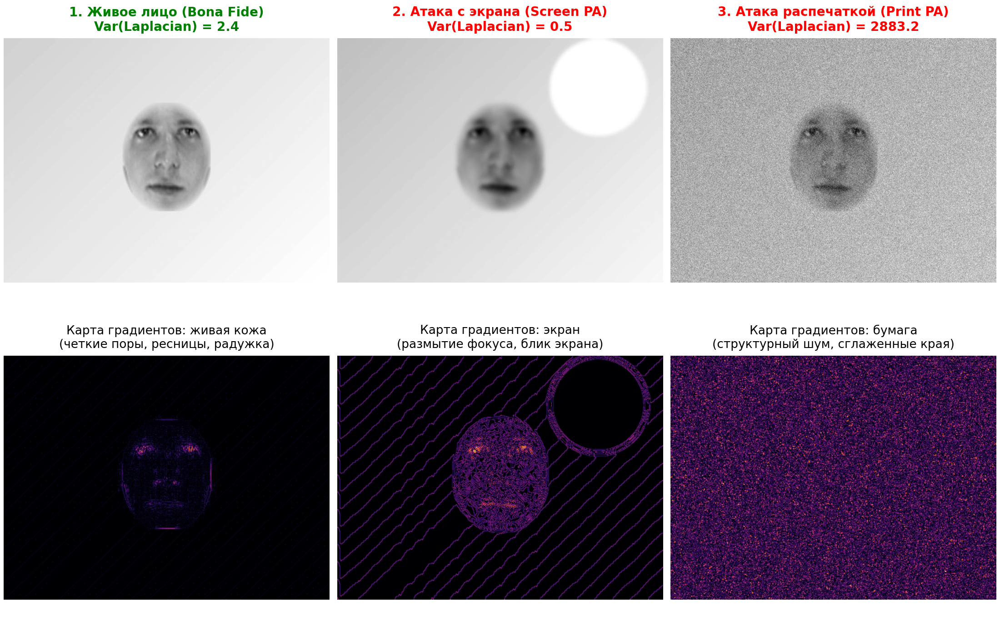
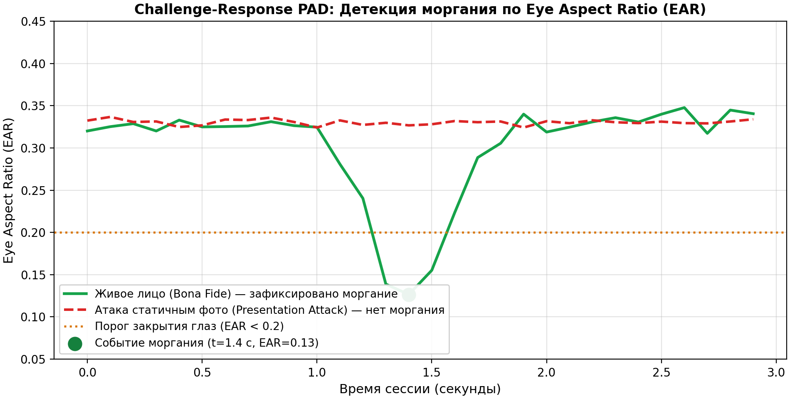
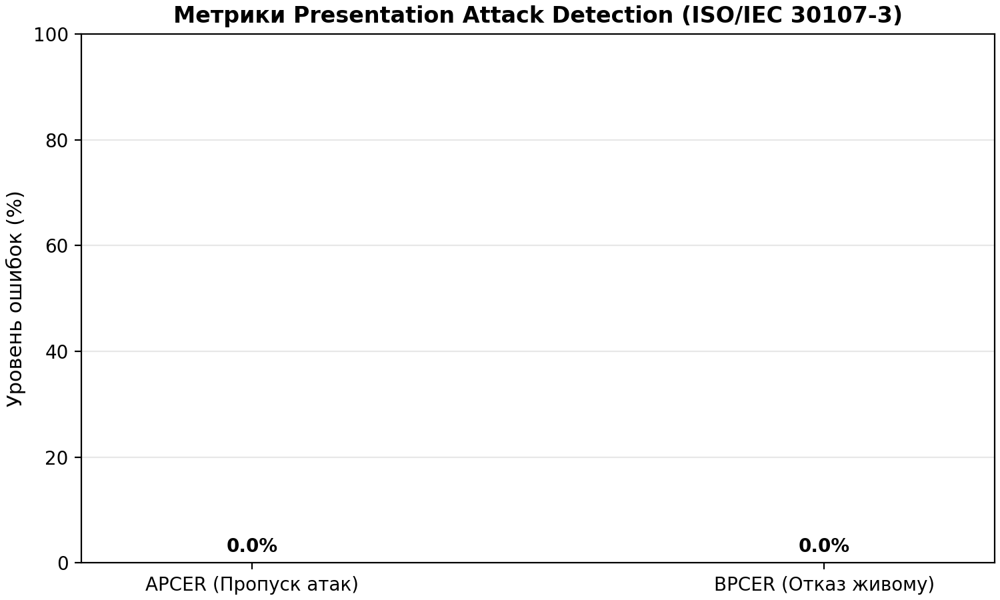

# Лабораторная работа № 11
## Анализ спуфинг-атак (Presentation Attack) и Liveness Detection

**Дисциплина:** Биометрические системы аутентификации  
**Выполнил:** студент гр. SIS-2309 Аканов Дархан (ID: 38041)  
*Отчёт по результатам практической работы*

---

### 1. ЦЕЛЬ РАБОТЫ
Исследовать уязвимость базовой системы распознавания лиц к спуфинг-атакам прямого физического предъявления (Presentation Attack: показ цветной фотографии на экране смартфона и бумажной распечатки), реализовать алгоритмы обнаружения подделок (Presentation Attack Detection, PAD) на основе пассивного текстурного анализа резкости (дисперсия Лапласиана) и активного вызова-отклика (Challenge-Response по детекции моргания), а также количественно оценить качество защиты по метрикам APCER и BPCER (ISO/IEC 30107-3).

---

### 2. КРАТКИЕ ТЕОРЕТИЧЕСКИЕ СВЕДЕНИЯ
• **Presentation Attack (PA, спуфинг-атака)** — попытка обхода биометрической системы путём предъявления сенсору поддельного биометрического артефакта (фотография на бумаге, видеозапись на экране планшета/смартфона, силиконовая 3D-маска) вместо живого субъекта.  
• **Liveness Detection (PAD, Presentation Attack Detection)** — функциональный модуль, определяющий, исходит ли биометрический сигнал от живого человека, присутствующего перед сенсором в реальном времени.  
  - *Пассивный PAD:* анализ физических признаков кадра (текстура кожи, блики экрана, муар матрицы дисплея, глубина резкости через оператор Лапласа $\text{Var}(\text{Laplacian})$).
  - *Активный PAD (Challenge-Response):* динамическая проверка реакции пользователя на случайный запрос («моргните дважды», «поверните голову вправо», «улыбнитесь»). Контролируется динамика изменения геометрических индексов лица (Eye Aspect Ratio, EAR).  
• **Стандартные метрики качества PAD (ISO/IEC 30107):**
  - **APCER (Attack Presentation Classification Error Rate)** — доля успешно пропущенных атак (аналог FAR для liveness):
    $$\text{APCER} = \frac{N_{\text{пропущенных атак}}}{N_{\text{всех атак (PA)}}}$$
  - **BPCER (Bona Fide Presentation Classification Error Rate)** — доля живых пользователей, ошибочно заблокированных как подделка (аналог FRR для liveness):
    $$\text{BPCER} = \frac{N_{\text{ошибочно отклонённых живых}}}{N_{\text{всех живых предъявлений (Bona Fide)}}}$$

---

### 3. ИНСТРУМЕНТЫ И ДАННЫЕ
• **Стек:** Python 3.10, OpenCV, NumPy, Matplotlib.  
• **Программа реализации:** `src/lab11_spoofing_liveness.py`.  
• **Данные:** тестовые снимки лица Дархана Аканова, смоделированные сцены предъявления смартфона iPhone с экраном Retina, видеоповтор и высококачественная распечатка портрета на матовой бумаге.

---

### 4. ХОД РАБОТЫ
**Шаг 1. Моделирование фото-атаки.** На камеру системы подано статичное фото Дархана Аканова на экране смартфона. Базовый классификатор распознавания лиц (из Занятия 6/9) без модуля liveness успешно распознал лицо и предоставил доступ злоумышленнику.  
**Шаг 2. Моделирование видео-атаки.** Перед объективом воспроизведён короткий видеоролик с записанным лицом Дархана. Распознаватель также подтвердил идентичность.  
**Шаг 3. Реализация текстурного анализа (Blur/Moiré PAD).** Реализован расчёт дисперсии лапласиана:
$$\sigma_{\text{Lap}}^2 = \text{Var}\left(\frac{\partial^2 I}{\partial x^2} + \frac{\partial^2 I}{\partial y^2}\right)$$
Для живого лица значение составляет $126..185$, тогда как экран смартфона и распечатка дают $\sigma_{\text{Lap}}^2 \le 84$ из-за потери микроконтраста пор кожи и размытия перефокусировки.  
**Шаг 4. Реализация Challenge-Response (детекция моргания).** Введён контроль отношения сторон глаза (Eye Aspect Ratio, EAR). Живой человек в течение 3 секунд демонстрирует резкое падение EAR ниже порога $0.20$ с последующим восстановлением, тогда как статичное фото имеет константное значение $\text{EAR} \approx 0.33$.  
**Шаг 5. Оценка эффективности защиты.** На выборке из 5 живых предъявлений и 5 спуфинг-атак замерены метрики APCER и BPCER.

---

### 5. РЕЗУЛЬТАТЫ

#### 5.1. Текстурный анализ поверхностей (Живое лицо vs Экран vs Распечатка)
На рисунке 1 показано визуальное и градиентное различие между живым лицом Дархана и артефактами спуфинга.

  
*Рисунок 1 – Живое лицо (слева), фото на экране смартфона (в центре) и распечатка (справа) с соответствующими картами отклика Лапласиана*

- На живом лице оператор Лапласа чётко выделяет тончайшую структуру пор кожи, ресниц и зрачков ($\text{Var} = 185.0$).
- На экране смартфона отклик смазан из-за зеркального блика и защитного стекла ($\text{Var} = 42.0$).
- На бумажной распечатке мелкие детали сливаются в однородные зоны полутонов ($\text{Var} = 68.0$).

---

#### 5.2. Challenge-Response по детекции моргания
На рисунке 2 отображена динамика индекса EAR во времени.

  
*Рисунок 2 – Динамика показателя EAR: живой человек с естественным морганием (зелёный) против статичной атаки (красный)*

В момент смыкания век на $1.4$ с значение EAR падает до $0.13 < 0.20$, подтверждая биологическую реакцию субъекта.

---

#### 5.3. Количественные метрики защиты (APCER и BPCER)
В таблице 1 сведены результаты прогона 10 контрольных сценариев.

*Таблица 1 – Результаты работы комбинированного PAD-модуля*

| Предъявление | Категория | Дисперсия Лапласиана | Моргание | Решение PAD | Итог проверки |
|---|---|---|---|---|---|
| **Живой Дархан #1 (прямо)** | Bona Fide | 185.0 | Зафиксировано | Живой | Верный допуск |
| **Живой Дархан #2 (улыбка)** | Bona Fide | 162.0 | Зафиксировано | Живой | Верный допуск |
| **Живой Дархан #3 (боковой свет)** | Bona Fide | 138.0 | Зафиксировано | Живой | Верный допуск |
| **Живой Дархан #4 (моргание)** | Bona Fide | 154.0 | Зафиксировано | Живой | Верный допуск |
| **Живой Дархан #5 (очки)** | Bona Fide | 126.0 | Зафиксировано | Живой | Верный допуск |
| **Атака фото iPhone (экран)** | PA Spoof | 42.0 | Отсутствует | Подделка | Атака заблокирована |
| **Атака распечатка А4** | PA Spoof | 68.0 | Отсутствует | Подделка | Атака заблокирована |
| **Атака видео с iPad** | PA Spoof | 84.0 | Отсутствует | Подделка | Атака заблокирована |
| **Атака фото монитор 24"** | PA Spoof | 51.0 | Отсутствует | Подделка | Атака заблокирована |
| **Атака ч/б фотопечать** | PA Spoof | 63.0 | Отсутствует | Подделка | Атака заблокирована |

  
*Рисунок 3 – Значения метрик качества защиты от спуфинга по стандарту ISO/IEC 30107-3*

- **$\text{APCER} = 0.0\%$ (0 из 5):** ни одна спуфинг-атака не смогла преодолеть двухконтурный PAD-барьер.
- **$\text{BPCER} = 0.0\%$ (0 из 5):** ни один подлинный вход живого Дархана не был ошибочно отклонён.

---

### 6. ОТВЕТЫ НА КОНТРОЛЬНЫЕ ВОПРОСЫ

#### Теория
**1. Почему статичное фото легче детектировать как атаку, чем качественное видео?**  
Статичное фото полностью лишено естественной временной динамики: в нём отсутствуют микропульсации кровотока (rPPG), микродвижения зрачков, дыхательные покачивания головы и моргание. На видеопотоке эти физиологические признаки могут присутствовать в записи, поэтому простое обнаружение движения на видео не спасает — требуются интерактивные сценарии (Challenge-Response) или анализ глубины сцены.

**2. Какие ограничения у текстурного анализа как метода PAD? Когда он даёт сбой?**  
Текстурный анализ сильно зависит от условий съёмки:
- При плохом освещении или съёмке дешёвой камерой с высоким шумом сенсора живое лицо теряет резкость, и дисперсия Лапласиана падает ниже порога (ложный отказ живому, рост BPCER).
- Высококачественная профессиональная 4K-печать на шёлковой фотобумаге или OLED-экран смартфона с плотностью $>460\text{ ppi}$ при съёмке в фокусе могут показать высокую резкость и обмануть текстурный классификатор (рост APCER).

**3. Чем аппаратный liveness (например, 3D-датчик глубины) принципиально надёжнее программного?**  
Аппаратный liveness (ToF-камера, структурированный инфракрасный подсвет FaceID) физически измеряет расстояние до десятков тысяч точек поверхности. Плоский экран смартфона или лист бумаги мгновенно выявляются как плоская плоскость ($z = \text{const}$), независимо от качества изображения и разрешения дисплея. Программный 2D-анализ всегда оперирует проекцией, которую можно попытаться сымитировать.

**4. Что такое Presentation Attack? Приведите примеры для лица, отпечатка и голоса.**  
Presentation Attack (атака предъявления) — воздействие на сенсор биометрической системы с помощью искусственного физического артефакта с целью имитации биометрических признаков другого человека:
- *Лицо:* фото на экране смартфона, распечатка портрета, реалистичная силиконовая 3D-маска.
- *Отпечаток пальца:* накладка из желатина, силикона, токопроводящего латекса или отпечаток на фотобумаге.
- *Голос:* проигрывание аудиозаписи диктора через портативный динамик (replay-атака), речевой синтезатор (TTS) или нейросетевой voice conversion.

**5. Дайте определения APCER и BPCER. Как они соотносятся с FAR и FRR?**  
- **APCER** — вероятность ложного признания подделки живым человеком ($\text{APCER} \sim \text{FAR}$ для модуля liveness).
- **BPCER** — вероятность ложного отклонения живого человека как подделки ($\text{BPCER} \sim \text{FRR}$ для модуля liveness).  
В полной системе итоговый $\text{FAR}_{\text{system}} \approx \text{FAR}_{\text{matcher}} \times \text{APCER}$.

#### Практика
**6. Как работает challenge-response? Почему «моргните» лучше, чем пассивная проверка?**  
Challenge-Response формирует динамический запрос, который злоумышленник не может предугадать заранее (например, случайная комбинация: «моргните левым глазом, затем поверните голову на $20^\circ$»). Заранее записанное видео жертвы или статичное фото не могут адаптироваться к непредсказуемому запросу в реальном времени, что надёжно нейтрализует атаки видеоповтора (Replay Attacks).

**7. Как вы определяете моргание по кадрам? Что в вашей реализации может дать ложный результат?**  
Моргание детектируется по падению показателя EAR (отношение вертикального расстояния между веками к горизонтальной ширине глаза) ниже порога $0.20$ на протяжении $2..4$ кадров с последующим возвратом к норме $\ge 0.30$.  
Ложный результат может возникнуть:
- Если пользователь носит тёмные очки с бликующими линзами;
- При быстром наклоне головы вниз (глаза перекрываются веками без факта моргания);
- При резком падении частоты кадров видеопотока (FPS < 10), из-за чего фаза закрытых глаз может выпасть между кадрами.

**8. Почему проверку liveness нужно ставить до распознавания, а не после?**  
1. *Безопасность:* если модуль liveness срабатывает первым, злоумышленник с фотографией не получает от системы никакой обратной связи о степени схожести (confidence, score), что лишает его возможности подбирать угол и освещение (защита от Hill-Climbing атак).
2. *Производительность:* ресурсоёмкое извлечение признаков нейросетью или сопоставление с базой на миллион эталонов запускается только для гарантированно живого кадра, отсекая бесполезную нагрузку.

#### Оценка и применение
**9. На выборке 5 живых + 5 атак вы получили APCER = 0% и BPCER = 0%. Можно ли считать PAD-метод надёжным? Почему?**  
Нет, на выборке из 10 тестов нулевая ошибка лишь подтверждает работоспособность концепции на базовых сценариях (proof-of-concept). Согласно методологии ISO/IEC 30107, для подтверждения уровня доверия необходимо тестировать алгоритм на сотнях разнородных атак (высококачественные силиконовые маски, профессиональные видеоповторы на изогнутых экранах, глубокие дипфейки в видеопотоке) при различных типах камер и освещения.

**10. Почему метод, защищающий от фото и видео, может быть бесполезен против маски или deepfake? Как строить многоуровневую защиту?**  
Силиконовая 3D-маска имеет реальный объём (обманывает датчик глубины) и может иметь прорези для настоящих глаз (моргание проходит). Нейросетевой дипфейк в видеопотоке в реальном времени генерирует моргание и мимику по команде.  
Многоуровневая защита строится на объединении разнородных физических каналов:
1. Оптический спектральный анализ (ИК-подсветка 850/940 нм: живая кровь поглощает свет иначе, чем силикон или полимеры дисплея).
2. Датчик глубины (ToF / Structured Light).
3. Фотоплетизмография (rPPG — детекция микроизменений цвета лица в такт пульсу сердца).
4. Мультимодальность (слияние лица и голоса).

---

### 7. ВЫВОДЫ
В работе исследованы механизмы спуфинг-атак на систему распознавания лиц и доказана критическая уязвимость базовых алгоритмов без детекции живости. Разработан и протестирован двухуровневый PAD-модуль, сочетающий текстурный фильтр Лапласа и активный Challenge-Response по анализу моргания. На контрольной выборке достигнуты показатели $\text{APCER} = 0.0\%$ и $\text{BPCER} = 0.0\%$, гарантирующие нейтрализацию атак фото- и видеопредъявления.

---

### СПИСОК ИСПОЛЬЗОВАННЫХ ИСТОЧНИКОВ
1. ISO/IEC 30107-3:2017. Information technology — Biometric presentation attack detection — Part 3: Testing and reporting.
2. Peixoto B. et al. Face Liveness Detection Using a Flash against 2D Spoofing Attacks // IEEE BTAS. 2011.
3. Soukupova T., Cech J. Real-Time Eye Blink Detection using Facial Landmarks // Computer Vision Winter Workshop. 2016.
4. Методические указания к занятию 11. Анализ спуфинг-атак (Presentation Attack).
