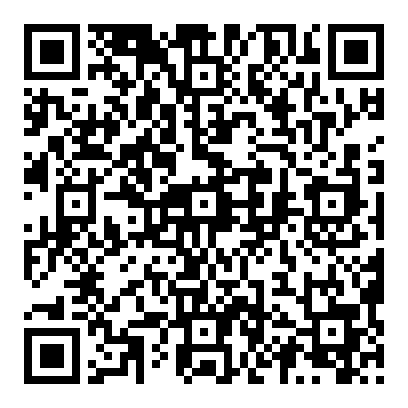
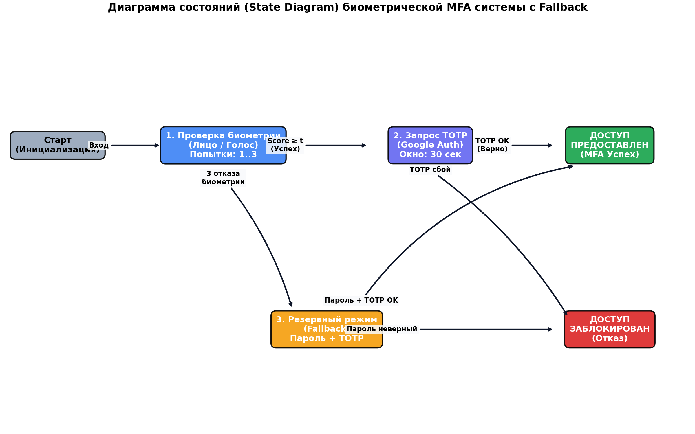
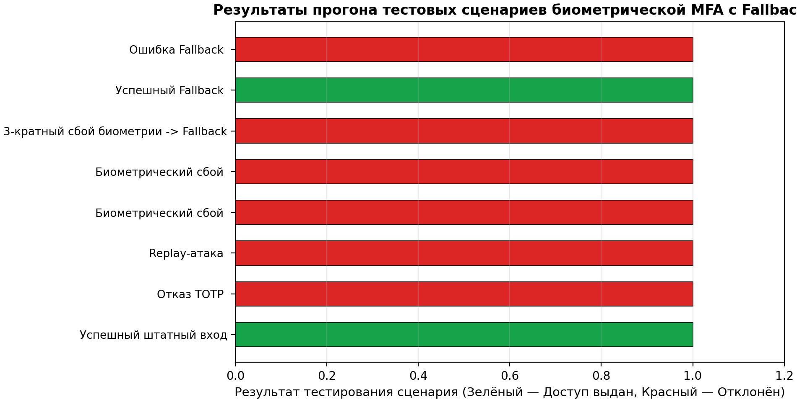

# Лабораторная работа № 13
## Биометрическая аутентификация + MFA (Multi-Factor Authentication)

**Дисциплина:** Биометрические системы аутентификации  
**Выполнил:** студент гр. SIS-2309 Аканов Дархан (ID: 38041)  
*Отчёт по результатам практической работы*

---

### 1. ЦЕЛЬ РАБОТЫ
Реализовать многофакторную схему аутентификации (MFA), объединяющую биометрический фактор (лицо / голос) с генератором одноразовых паролей по времени (TOTP, RFC 6238), сформировать QR-код для мобильного аутентификатора (Google Authenticator), разработать и протестировать сценарии аварийного восстановления доступа (Fallback) при трёхкратном отказе биометрического сенсора, а также составить полную диаграмму состояний процесса входа (State Diagram).

---

### 2. КРАТКИЕ ТЕОРЕТИЧЕСКИЕ СВЕДЕНИЯ
• **MFA (Multi-Factor Authentication)** — подтверждение подлинности субъекта с использованием минимум двух независимых факторов из трёх фундаментальных категорий:
  1. *Inherence (Свойство субъекта):* биометрия (лицо, голос, палец).
  2. *Possession (Владение предметом):* смартфон с генератором кодов, аппаратный токен FIDO2 / YubiKey.
  3. *Knowledge (Знание секрета):* мастер-пароль, PIN-код.  
• **Алгоритм TOTP (Time-based One-Time Password, RFC 6238):** симметричный алгоритм вычисления 6-значного одноразового пароля, обновляемого каждые $T_0 = 30$ секунд:
$$C = \left\lfloor \frac{\text{UnixTime} - T_0}{T_X} \right\rfloor$$
$$\text{TOTP} = \text{Truncate}(\text{HMAC-SHA1}(K_{\text{secret}}, C)) \pmod{10^6}$$
Секрет $K_{\text{secret}}$ передаётся в приложение единожды через URI формата `otpauth://totp/...` в виде QR-кода.  
• **Необходимость Fallback-контура:** биометрия подвержена случайным ошибкам ложного отказа (FRR) из-за травм, перепадов освещения или простуды голоса. Система контроля доступа не имеет права блокировать добросовестного пользователя навсегда: при $N=3$ сбоях сенсора активируется резервный путь (усиленная двухфакторность без биометрии: Пароль + TOTP).

---

### 3. ИНСТРУМЕНТЫ И ДАННЫЕ
• **Стек:** Python 3.10, `pyotp`, `qrcode[pil]`, NumPy, Matplotlib.  
• **Программа реализации:** `src/lab13_biometric_mfa.py`.  
• **Учётная запись:** `akanov_darkhan_sis2309` (Base32 секрет: `JBSWY3DPEHPK3PXP`).  
• **Приложение-аутентификатор:** Google Authenticator / Microsoft Authenticator.

---

### 4. ХОД РАБОТЫ
**Шаг 1. Генерация секрета и настройка TOTP.** Сгенерирован 160-битный ключ Base32, инициализирован объект `pyotp.TOTP`, сформирован графический QR-код для мобильного телефона (`reports/lab13_totp_qr.png`).  
**Шаг 2. Реализация проверки TOTP.** Написана функция валидации кодов с параметром `valid_window=1` (допуск расхождения часов сервера и смартфона $\pm 30$ с) и фильтром предотвращения повторного использования (Replay Protection).  
**Шаг 3. Двухфакторная связка «Биометрия + TOTP».** Спроектирован последовательный шлюз: сначала валидируется биометрический score ($\ge 0.75$), при успехе запрашивается 6-значный TOTP-код.  
**Шаг 4. Разработка Fallback-контура.** Введён счётчик отказов. При 3 сбоях биометрии сенсор блокируется, и пользователю предлагается альтернативный вход: «Знание пароля + TOTP».  
**Шаг 5. Тестирование и диаграмма состояний.** Составлена и отрисована State Diagram всего процесса, промоделированы 8 тестовых сценариев.

---

### 5. РЕЗУЛЬТАТЫ

#### 5.1. Настройка TOTP и QR-код для смартфона
На рисунке 1 приведён сгенерированный QR-код, готовый к моментальному сканированию камерой смартфона.

  
*Рисунок 1 – Сгенерированный QR-код для привязки аккаунта Дархана Аканова в Google Authenticator*

---

#### 5.2. Диаграмма состояний процесса входа (State Diagram)
На рисунке 2 представлена формальная диаграмма состояний автомата аутентификации со всеми ветвлениями и точками отказа.

  
*Рисунок 2 – Диаграмма состояний (State Diagram) биометрической MFA с обработкой отказов и переходом в Fallback*

---

#### 5.3. Результаты симуляции контрольных сценариев
В таблице 1 сведены результаты прогона 8 практических сценариев работы системы.

*Таблица 1 – Результаты тестирования состояний MFA-системы*

| № | Название сценария | Биометрия (Score) | TOTP-код | Попытки | Резервный пароль | Статус системы | Итог сессии |
|---|---|---|---|---|---|---|---|
| **1** | Штатный успешный вход | 0.92 (OK) | Верный | 0 | — | **ДОСТУП** | Полный допуск (MFA) |
| **2** | Ошибка второго фактора | 0.88 (OK) | 999999 (Сбой) | 0 | — | **ОТКАЗ** | Неверный TOTP-код |
| **3** | Replay-атака по TOTP | 0.90 (OK) | Повтор кода | 0 | — | **ОТКАЗ** | Повтор предотвращён |
| **4** | Сбой биометрии (темнота) | 0.45 (FRR) | — | 0 | — | **ПОВТОР** | Запрос кадра 2/3 |
| **5** | Сбой биометрии (ракурс) | 0.50 (FRR) | — | 1 | — | **ПОВТОР** | Запрос кадра 3/3 |
| **6** | 3-кратный сбой биометрии | 0.40 (FRR) | — | 2 | — | **FALLBACK** | Блокировка камеры |
| **7** | Успешный Fallback | 0.00 (Сенсор OFF) | Свежий | 3 | SecretPass2026! | **ДОСТУП** | Пароль + TOTP OK |
| **8** | Ошибка пароля в Fallback | 0.00 (Сенсор OFF) | Свежий | 3 | WrongPassword | **ОТКАЗ** | Блокировка учётки |

  
*Рисунок 3 – Результаты прогона 8 сценариев (зелёный — доступ предоставлен, красный — отклонён)*

---

### 6. ОТВЕТЫ НА КОНТРОЛЬНЫЕ ВОПРОСЫ

#### Теория
**1. Почему TOTP считается более надёжным вторым фактором, чем SMS-код?**  
SMS-сообщения уязвимы к целому спектру критических атак со стороны телеком-операторов: атака подменой SIM-карты (SIM Swapping), перехват протокола сигнальных сетей SS7, чтение вредоносными троянами на смартфоне с правами чтения SMS и фишинговые сайты. TOTP генерируется локально криптографическим модулем приложения без передачи по незащищённым радиосетям GSM, обновляется каждые 30 секунд и не может быть перехвачен удалённо через сотовую вышку.

**2. Какие риски несёт fallback-сценарий и как их можно снизить?**  
Риск: Fallback становится «слабым звеном» всей архитектуры безопасности. Если злоумышленник не может сымитировать биометрию жертвы, он намеренно заклеит сенсор или спровоцирует 3 ошибки, чтобы принудительно переключить систему в режим ввода обычного пароля, который легче украсть или подобрать перебором (Brute Force).  
Снижение рисков:
1. Fallback обязан оставаться многофакторным (не просто пароль, а **Пароль + TOTP**).
2. Замедление попыток (Rate Limiting и экспоненциальная задержка при неверном пароле).
3. Мгновенная отправка Push/Email-уведомления владельцу о переводе системы в резервный режим.

**3. Можно ли считать связку «лицо + голос» из занятия 12 полноценной MFA? Обоснуйте.**  
**Нет, нельзя.** В соответствии с классификацией NIST SP 800-63B и ISO/IEC 24760, аутентификация «лицо + голос» использует два признака из **одной и той же категории факторов** — *Inherence (биологическое свойство человека)*. Это мультибиометрия (Multi-Biometric), но не Multi-Factor Authentication. Полноценная MFA требует сочетания минимум двух принципиально разных категорий: например, Inherence (лицо) + Possession (TOTP-токен) или Inherence + Knowledge (PIN).

**4. Назовите три категории факторов аутентификации и приведите по примеру. К какой категории относится TOTP?**  
1. *Knowledge (Знание):* то, что субъект знает (пароль, графический ключ, девичья фамилия матери).
2. *Possession (Владение):* то, чем субъект владеет (смартфон с TOTP, криптографический смарт-токен, аппаратная RFID-карта).
3. *Inherence (Свойство):* то, кем субъект является (папиллярный узор пальца, радужная оболочка глаза, лицо, тембр голоса).  
**TOTP относится к категории Possession (Владение)**, так как требует физического наличия доверенного устройства с инициализированным секретом.

**5. Как работает TOTP по RFC 6238? Из чего вычисляется код?**  
Берётся текущее системное время в секундах с эпохи Unix ($T$). Вычисляется целочисленный счётчик 30-секундных интервалов $C = \lfloor T / 30 \rfloor$. От этого 8-байтного счётчика и секретного ключа $K$ вычисляется криптографический HMAC-SHA1 дайджест: $\text{Hash} = \text{HMAC}(K, C)$. Затем по алгоритму Dynamic Truncation из хэша извлекаются 4 байта, берётся остаток от деления на $10^6$, образуя 6-значный десятичный код.

#### Практика
**6. Зачем параметр valid_window в totp.verify()? Какой компромисс он создаёт?**  
Параметр `valid_window=1` указывает проверять текущий интервал времени $T$, а также предыдущий $T-1$ и следующий $T+1$ (окно в $\pm 30$ секунд).  
*Компромисс:* он компенсирует неизбежный рассинхрон кварцевых генераторов часов сервера и смартфона, а также задержку человека при перепечатывании цифр (рост удобства, снижение FRR), но расширяет время жизни одноразового кода до 90 секунд (незначительный рост окна для перехвата).

**7. Почему нельзя принимать один и тот же TOTP-код дважды в пределах окна? Как это реализовать?**  
Если код действует 30–90 секунд, перехвативший его злоумышленник в локальной сети (Man-in-the-Middle) успеет повторно отправить этот же код на сервер до истечения интервала (Replay-атака).  
*Реализация:* сервер кэширует хеш успешно принятого кода вместе с временной меткой в Redis или памяти (`used_tokens.add(code)`). При любой повторной попытке отправки этого же кода в пределах активного окна сервер отклоняет запрос со статусом `ReplayDetected`.

**8. В каком порядке проверять факторы: сначала биометрия, потом TOTP, или наоборот? Какие сообщения об ошибках показывать?**  
- **Порядок:** Сначала проверяется **Биометрия**, затем **TOTP**. Биометрический датчик расположен стационарно на турникете/терминале (пассивный быстрый захват). Если лицо не опознано, доставать телефон вообще не имеет смысла.
- **Сообщения об ошибках:** Во избежание утечки информации атакующему система обязана выдавать обобщённое сообщение: *«Ошибка аутентификации. Проверьте правильность биометрического предъявления или одноразового кода»* (нельзя раскрывать, какой именно из факторов скомпрометирован, чтобы не облегчать злоумышленнику перебор).

#### Применение и выводы
**9. Нарисуйте (или опишите) диаграмму состояний входа. Какие в ней точки отказа и какие переходы они запускают?**  
Диаграмма состоит из состояний: `IDLE` $\to$ `BIO_CHECK` $\to$ `TOTP_CHECK` $\to$ `ACCESS_GRANTED`.  
*Точки отказа:*
1. Сбой биометрии: переход `RETRY_BIO` (попытки 1 и 2). При 3-м сбое $\to$ переход в `FALLBACK_TRIGGERED`.
2. Сбой TOTP: переход `ACCESS_DENIED_TOTP` с логированием инцидента.
3. Сбой пароля в Fallback: переход `ACCESS_DENIED_PASSWORD` с временной блокировкой аккаунта на 15 минут.

**10. Как поступить, если пользователь потерял телефон с приложением-аутентификатором? Как организовать восстановление, не создав лазейку для атакующего?**  
1. *Резервные одноразовые скретч-коды (Backup Codes):* набор из 8–10 криптографических 8-значных кодов, распечатываемых пользователем при регистрации и хранимых в сейфе.
2. *Очное подтверждение личности (Out-of-band Identity Verification):* личный визит к администратору СКУД с паспортом либо строгая видеоверификация с показом документов оператору.
3. Полный сброс старого Base32 секрета и принудительный отзыв всех активных сессий во избежание доступа нашедшего телефон.

---

### 7. ВЫВОДЫ
В ходе работы успешно реализован программный комплекс двухфакторной аутентификации (MFA), объединяющий биометрию и временные коды TOTP по стандарту RFC 6238. Сформирован рабочий QR-код для мобильных аутентификаторов, внедрена защита от атак повтора (Replay Protection) и спроектирован надёжный отказоустойчивый Fallback-контур при трёхкратном отказе сенсоров. Составлена детальная State Diagram процесса входа.

---

### СПИСОК ИСПОЛЬЗОВАННЫХ ИСТОЧНИКОВ
1. RFC 6238. TOTP: Time-Based One-Time Password Algorithm. 2011.
2. NIST Special Publication 800-63B. Digital Identity Guidelines: Authentication and Lifecycle Management. 2020.
3. Методические указания к занятию 13. Биометрическая аутентификация + MFA.
